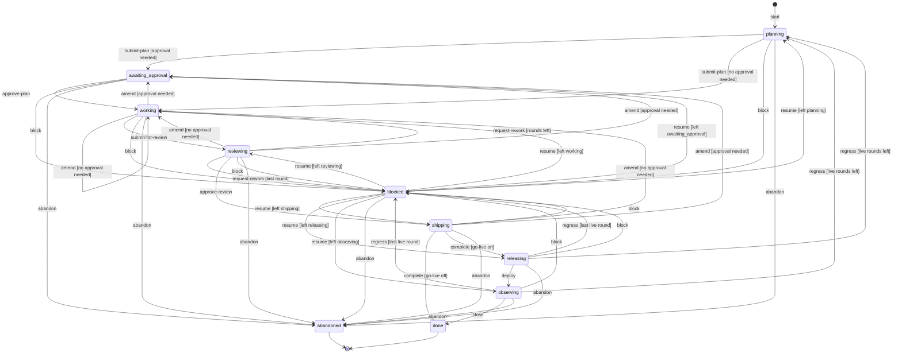
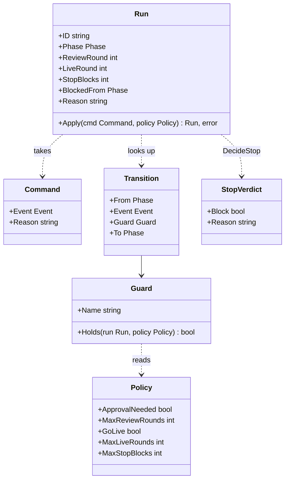
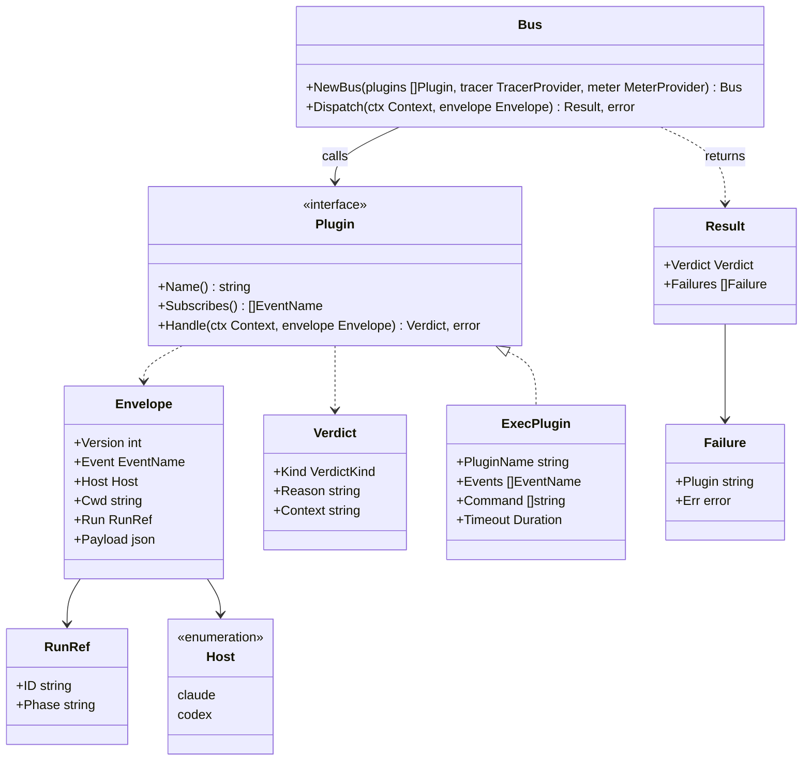
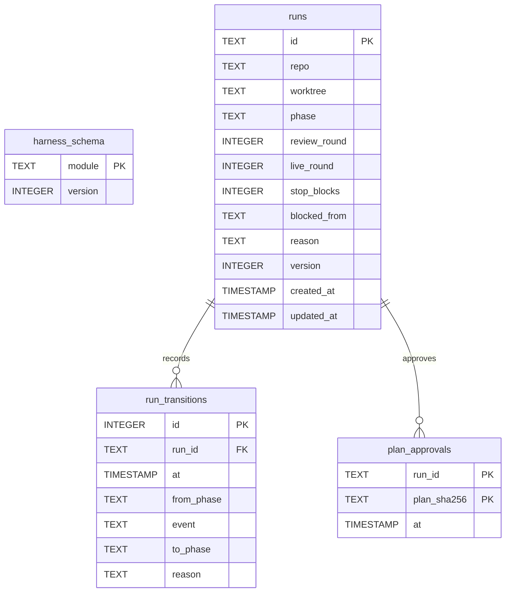
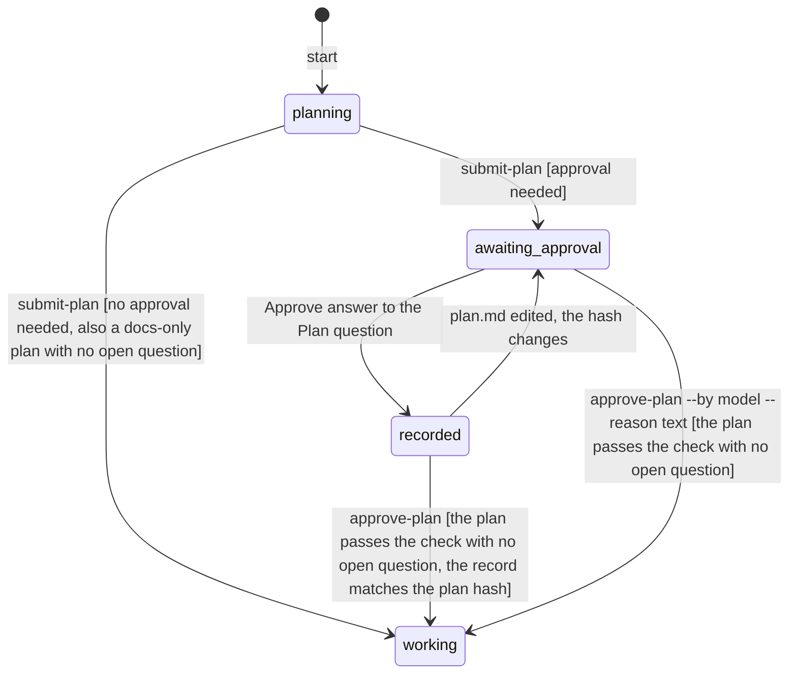
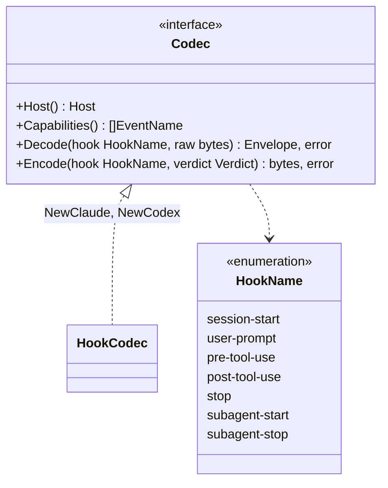

# Design

The harness is a Go binary that drives an AI coding agent through a deterministic loop. It plans, works, reviews, ships and watches production. Plugins can veto or extend each step.

## Modules

Each module is a bounded context under `internal/<module>/`. It has the layers `domain/`, `application/` and `infrastructure/`. Code that two modules use lives in `internal/shared/<layer>/`.

- A `module.go` file in each module is the only file that imports across its layers.
- `cmd/harness` wires the modules and holds no rule.
- A use case is `application/command/<name>/` or `application/query/<name>/`, with its message and its handler.
- A command handler returns only an error.
- A bus is not a use case. It lives in `application/<bus>/`.

`TestLayerImports` checks the direct imports of each package:

- A `domain` package imports only the standard library and `internal/shared/domain`.
- An `application` package imports no `go.opentelemetry.io/otel/sdk` package and no `infrastructure` package.
- A `ui` package imports no `infrastructure` package.

| Module | Path | Job |
|---|---|---|
| telemetry | `internal/shared/infrastructure/telemetry` | OpenTelemetry SDK setup, OTLP export, shutdown |
| run | `internal/run/domain` | Run aggregate, phases, guarded transitions, stop decision |
| shared bus | `internal/shared/{domain,application/eventbus,infrastructure/execplugin}` | Event catalogue, envelope, verdicts, event bus, exec adapter |
| dbal | `internal/shared/infrastructure/dbal` | Dialects, migrations, transactions, optimistic locks |
| run store | `internal/run/infrastructure/persistence` | `RunRepository` adapter on the DBAL |
| config | `internal/shared/infrastructure/config` | File, env and flags with viper |
| run use cases | `internal/run/application` | `harness run` commands and queries |
| plan | `internal/plan` | Plan parse and checks, plan view |
| host | `internal/host` | Claude Code and Codex hook codecs |
| guard | `internal/guard` | Built-in guard rules as in-process plugins on `tool.before` and `turn.stopping` |
| gate | `internal/gate` | Verification gates from YAML, baseline ratchet, evidence |
| lint | `internal/lint` | Rule packs |
| live | `internal/live` | Merge and deploy records, signal checks, regression findings |
| deploy | `internal/deploy` | Default deploy tool plugins (`helm`, `promtool`) on `gates.detect` and `chart.render`, and the chart render query |
| report | `internal/report` | Harness bug reports: section check, redaction, the GitHub issue |

`ROADMAP.md` gives the pull request that builds each module.

## Loop

A run moves through phases. The transition table is deterministic: a row is `(from, event, guard) -> to`. The guards of one `(from, event)` pair exclude each other, so only one row applies.

`Policy.ApprovalNeeded` comes from the config `run.approval`. `Flow.Move` turns it off for one `submit-plan` call when the plan gate reports a waiver: every commit of the plan is `docs`, and `## Open questions` holds only `- none`. An `amend` never takes the waiver.

Each guard is a named pure function of the run and the policy:

| Guard | Holds when |
|---|---|
| `approval needed` | `policy.ApprovalNeeded` or `run.LiveRound > 0` |
| `no approval needed` | not `approval needed` |
| `rounds left` | `run.ReviewRound + 1 < policy.MaxReviewRounds` |
| `last round` | not `rounds left` |
| `go-live on` | `policy.GoLive` |
| `go-live off` | not `policy.GoLive` |
| `live rounds left` | `run.LiveRound + 1 < policy.MaxLiveRounds` |
| `last live round` | not `live rounds left` |
| `left` plus a phase | `run.BlockedFrom` is that phase |

A row with no guard always holds. The `approval needed` guard reads `LiveRound`. So each replan after a regression waits for approval, also when approval is off.

The diagram shows the table. In the diagram, `[*]` on the left is the phase none. The line `X --> [*]` marks a terminal phase with no outgoing row. A test compares the diagram with `domain.Transitions()`.



The effects of each event on the run, besides the phase:

| Event | Effect |
|---|---|
| any | `StopBlocks` goes to 0 |
| `approve-plan` | `Track` keeps the stricter of the run track and the plan track, `ReviewRound` goes to 0 |
| `request-rework` into `working` | `ReviewRound` goes up by 1, `Reason` holds the findings |
| any event into `blocked` | `BlockedFrom` holds the old phase, `Reason` holds the reason or the findings |
| `resume` | `BlockedFrom` and `Reason` are cleared |
| `regress` into `planning` | `LiveRound` goes up by 1, `ReviewRound` goes to 0, `Reason` holds the regression findings |

The Go types are in `internal/run/domain`:

| File | Content |
|---|---|
| `phase.go` | `Phase`, one constant for each phase, `Phase.HoldsTheTurn()` |
| `event.go` | `Event`, one constant for each event of the diagram |
| `command.go` | `Command{Event, Reason}` |
| `policy.go` | `Policy{ApprovalNeeded, MaxReviewRounds, GoLive, MaxLiveRounds, MaxStopBlocks}` |
| `guard.go` | `Guard{Name, Holds}`, one variable for each guard |
| `transition.go` | `Transition{From, Event, Guard, To}`, `Transitions()` returns a copy of the table |
| `run.go` | `Run`, `Run.Apply(cmd, policy) (Run, error)` |
| `stop.go` | `StopVerdict{Block, Reason}`, `DecideStop(run, policy, agentRunning)` |
| `errors.go` | `ErrIllegalTransition`, wrapped with the phase and the event |

The caller gives `Run.ID`. A new run is `Run{ID: id}` in the phase none, and `start` moves it to `planning`.

`Phase.HoldsTheTurn` is true for `planning`, `working`, `reviewing` and `shipping`. The phases `releasing` and `observing` wait for production, so they do not hold the turn.

`DecideStop` blocks the end of an agent turn only when all three facts hold:

1. The phase holds the turn.
2. No agent runs.
3. `StopBlocks` is below `MaxStopBlocks`.

When it blocks, it returns the run with `StopBlocks` plus 1. The reason names the phase.



## Plugin events

A plugin is a building block. Built-in pieces and exec plugins implement the same `Plugin` port. The bus sends each event to the plugins that subscribe to it, in name order.

The guard builds one plugin named `guard.<id>` for each rule that is not in `guard.disabled`. The bus puts the plugin name before each deny. The rules are:

| Rule | Event | Denies |
|---|---|---|
| `pr-no-merge` | `tool.before` | `gh pr merge` |
| `pr-draft-only` | `tool.before` | `gh pr create` without `--draft` |
| `pr-body-shape` | `tool.before` | A PR body with no `## Why`, `## What` or `## How`, these sections out of order, a line above 40 words, or a diagram with no marks |
| `git-no-force` | `tool.before` | A forced `git push` |
| `git-no-push-default` | `tool.before` | A `git push` to the default branch |
| `git-no-verify-skip` | `tool.before` | `--no-verify` on `git commit` or `git push` |
| `secrets-read` | `tool.before` | A read of a secret file |
| `test-no-focus-skip` | `tool.before` | A focused or skipped test in a test edit |
| `shell-write-source` | `tool.before` | A shell write to a source file |
| `writing-style` | `tool.before` | An em dash, an emoji or a Co-Authored-By line in commit or PR text |
| `agent-model-routing` | `tool.before` | An agent call whose model is not in the list of its role for the host, or that has no model |
| `review-models` | `run.transition.before` | `harness run ship` (the `approve-review` transition) when fewer than 2 models have a record on `HEAD`. Also when a reviewer model of the host list has no record |
| `commits-checked` | `tool.before` | `git push` or `gh pr create` without a passed commit check for `HEAD`, or with no `HEAD`. A push that only deletes remote refs is allowed |
| `approval-no-forge` | `tool.before` | A question tool call with `answers` in its input, or a shell command that runs `harness hook` or `go run ./cmd/harness hook` |
| `stop-holds-turn` | `turn.stopping` | A stop in a phase that holds the turn, as the run stop decision says |

After each Agent call of the `reviewer` role, a hook writes a review record: the repo, `HEAD` and the model, in the gate state beside the commit checks. The rule `review-models` reads the models of `HEAD` and needs every reviewer model of one host list, and at least 2 models. The ship transition carries no host, so the rule picks the host list with the most recorded models. A host list of one model still gets the deny, with the `roles.reviewer` next step. A background agent sends `tool.after` at dispatch, so a record proves a dispatch, not a finished review. `subagent.stopped` carries no model, so this limit stays. A repository on Codex sets `guard.disabled: [review-models]`, because Codex sends no Agent call with a model.

Event kinds:

- `veto`: a deny stops the dispatch and goes to the caller. The bus keeps the context texts. A plugin failure is a deny, so a veto fails closed.
- `collect`: the bus calls every plugin and joins all denies into one deny. It keeps the context texts. It reports plugin failures apart, and the caller decides.
- `context`: the bus keeps the context texts and drops a deny.
- `observe`: the bus drops every verdict.

| Event | Kind | Source |
|---|---|---|
| `session.started` | context | host hook |
| `prompt.submitted` | veto | host hook |
| `tool.before` | veto | host hook |
| `tool.after` | context | host hook |
| `turn.stopping` | veto | host hook |
| `subagent.started` | context | host hook |
| `subagent.stopped` | observe | host hook |
| `run.transition.before` | veto | run module |
| `run.transition.after` | observe | run module |
| `plan.submitted` | collect | plan module |
| `gate.before` | veto | gate module |
| `gate.after` | observe | gate module |
| `signals.check` | collect | live module |
| `gates.detect` | collect | gate module |
| `chart.render` | collect | lint module |
| `lint.check` | collect | lint module |
| `lint.prepare` | collect | lint module |

A `signals.check` plugin reads one signal source, such as Prometheus or an OpenTelemetry backend. It denies on a breached threshold. The joined deny reasons become the regression findings.

A deploy tool plugin works on `gates.detect`, and optionally on `chart.render`. The data goes back in `Verdict.Context`:

| Event | Payload | Answer in `context` |
|---|---|---|
| `gates.detect` | `{"files": [...]}`, the tracked and untracked files of the repo | one JSON gate on each line: `{"id":"...","run":"...","paths":[...],"needs":[...]}`, `paths` and `needs` optional; a line with `"setup":true` is a setup step, with an optional `"creates":"..."` and no `needs` |
| `chart.render` | `{"chart": "deploy/chart"}`, with `cwd` the folder to render in | the rendered manifest in the `helm template` format: each document starts with a `# Source: <chart name>/<file>` comment, and the lint puts the chart folder in place of the chart name |

The deploy module builds the default plugins `helm` and `promtool`, except the names in `deploy.disabled`. They propose nothing without their files:

| Plugin | Files | Gate | Renders |
|---|---|---|---|
| `helm` | each `Chart.yaml` that is not below the folder of another chart | `helm-render`: `helm template <chart> > /dev/null`, joined with `&&` | `helm template <chart>` |
| `promtool` | each `*.rules.test.yaml` | `promtool-test`: `find <top folders> -name '*.rules.test.yaml' -exec promtool test rules {} +` | no |

An exec plugin writes a verdict on stdout, so the gate line is a JSON string inside `context`:

```json
{"verdict":"allow","context":"{\"id\":\"kubeconform\",\"run\":\"kubeconform -summary deploy\"}"}
```

Only one plugin renders a chart. An exec plugin on `chart.render` while `helm` is on is a config error. With no renderer, the chart rules stop with `no plugin rendered the chart`. A document with no `# Source:` comment also stops them, so a render in another format cannot pass as clean.

A plugin on `run.transition.before` or `run.transition.after` can filter by `transition`, `from` and `to`. The transitions are `start`, `submit-plan`, `approve-plan`, `amend`, `request-rework`, `submit-for-review`, `approve-review`, `complete`, `deploy`, `close`, `regress`, `block`, `resume` and `abandon`. The phases are `planning`, `awaiting_approval`, `working`, `reviewing`, `shipping`, `releasing`, `observing`, `blocked`, `done` and `abandoned`. Values in one key are an OR, and the keys together are an AND. No filter matches all transitions.

The payload is `{"event","from","to","reason"}`. In the `run.transition.before` payload `to` is the phase that the transition would reach. On `run.transition.after`, the envelope `run.phase` is the source phase, so a plugin reads `payload.to`. The transition `start` has an empty `from`.

A plugin may implement the optional `Matcher` interface. The bus calls `Matches` before `Handle` and skips a plugin that does not match. A skipped plugin gets no span and no process. The exec plugin builds its `Matcher` from the filter keys.

The envelope goes to the plugin on stdin. Its version is 1.

```json
{"version":1,"event":"tool.before","host":"claude","cwd":"/repo","run":{"id":"r1","phase":"working"},"payload":{"tool":"Bash","input":{"command":"git push"}}}
```

The plugin writes the verdict on stdout. An empty stdout is an allow.

```json
{"verdict":"allow|deny|context","reason":"...","context":"...","findings":[]}
```

Dispatch rules:

- `Dispatch(ctx, envelope)` returns `ErrUnknownEvent` before any call when the event is not in the catalogue.
- The bus calls the subscribed plugins one after the other, in name order.
- A deny reason in the result is the plugin name, `: ` and its reason. The bus joins several reasons with a newline.
- The bus joins context texts with a blank line.
- On a collect event, the bus joins the `findings` of all plugins in name order. It drops them on the other kinds.
- A `Failure` is `{Plugin, Err}`. On a veto event, a failure is a deny with the reason `plugin failed: ` plus the error.
- A verdict with a kind other than `allow`, `deny` or `context` is a failure.
- On a context or observe event, the result verdict is an allow.

The exec adapter `ExecPlugin{PluginName, Events, Command, Timeout}`:

- It runs `Command` with `exec.CommandContext` in a new process group. The default timeout is 5 seconds. `WaitDelay` is 500 ms, because a child that keeps stdout open blocks `Wait` without it.
- On a timeout, it sends SIGTERM to the process group, waits 2 seconds, then sends SIGKILL to the group. So a child, such as a `docker` client, does not stay alive. A plugin that starts a container must also stop it: `docker compose run` exits on SIGTERM but leaves its container running.
- It writes the envelope on stdin and reads the verdict from stdout.
- It runs the command in the envelope `cwd`, so a relative command such as `./scripts/gate.sh` works from any subfolder. A `cwd` that does not exist is a plugin failure.
- The plugin stderr goes to the harness stderr as it comes, once.
- A timeout, a non-zero exit or invalid JSON returns `ErrPluginFailed` with the cause. The error holds no copy of the stderr.
- It injects the W3C trace context into the env var `TRACEPARENT`.



## Telemetry

OpenTelemetry is mandatory. Every command and hook starts the providers.

- `Setup(ctx, version) (shutdown, err)` installs one SDK `TracerProvider` and one `MeterProvider` as the global providers. It does this also when it returns an error.
- The resource has `service.name` `harness` and `service.version` from the argument.
- One signal reads the first endpoint env that is set, in this order: `HARNESS_OTEL_EXPORTER_OTLP_TRACES_ENDPOINT`, `OTEL_EXPORTER_OTLP_TRACES_ENDPOINT`, `HARNESS_OTEL_EXPORTER_OTLP_ENDPOINT`, `OTEL_EXPORTER_OTLP_ENDPOINT`. Metrics use the same order with `METRICS`.
- A general name gets `/v1/traces` or `/v1/metrics` joined to its path. A signal name is used as it is. The harness passes the chosen URL to the exporter. An error names the variable that it read.
- An endpoint without the `http` or `https` scheme is an error, and that signal gets no exporter. The scheme also sets insecure, so `OTEL_EXPORTER_OTLP_*_INSECURE` has no effect.
- The exporters use OTLP over HTTP with protobuf. The other `OTEL_*` variables, such as the headers, have no `HARNESS_` alias. So they do not apply under Claude Code.
- Traces go through a batch span processor. Metrics go through a periodic reader. The shutdown flushes both.
- The exporters have retry off. `ShutdownTimeout` is 2 seconds, and `shutdown` uses one deadline for both providers.
- Only `infrastructure/` imports the SDK. Application code takes a `trace.TracerProvider` and a `metric.MeterProvider` of the API.

Signals of the plugin bus:

| Signal | Kind | Attributes |
|---|---|---|
| `plugin.call` | span | `harness.event`, `harness.plugin`, `harness.verdict` |
| `harness.plugin.duration` | histogram, unit `s` | `harness.event`, `harness.plugin`, `harness.verdict` |

- The value of `harness.verdict` is `allow`, `deny`, `context` or `failure`.
- The histogram buckets are 0.005, 0.01, 0.025, 0.05, 0.1, 0.25, 0.5, 1, 2.5, 5 and 10 seconds.
- The instrumentation scope is the import path of the eventbus package.

Signals of lint:

| Signal | Kind | Attributes |
|---|---|---|
| `lint.run` | span | none |
| `lint.engine` | span, child of `lint.run`, one for each engine | `harness.lint.engine`, `harness.lint.rules`, `harness.lint.findings` |
| `lint.findings` | event of `lint.engine`, one for each rule and severity pair | `harness.lint.rule`, `harness.lint.severity`, `harness.lint.count` |
| `harness.lint.findings` | counter | `harness.lint.rule`, `harness.lint.severity` |

- On an engine error, `lint.engine` records the error and has the error status.
- A gate child process gets `TRACEPARENT` from the gate runner. A command reads it at start and makes it the parent of its spans. The whole verify call forms one tree under `gate.verify`, with the lint spans under `gate.run`. A missing or bad value starts a new root.

Signals of verify:

| Signal | Kind | Attributes |
|---|---|---|
| `gate.verify` | span, root of one verify call | `harness.gate.count`, `harness.worktree`, `harness.run.id` |
| `gate.setup` | span, child of `gate.verify`, one for each setup step that runs | `harness.setup.step` |
| `gate.run` | span, child of `gate.verify`, one for each gate | `harness.gate`, `harness.gate.cached`, `harness.gate.result` |
| `gate.verify_commits` | span, root of one `verify --commits` call | `harness.worktree`, `harness.run.id` |
| `gate.verify_commit` | span, child of `gate.verify_commits`, one for each commit | `harness.commit` |

- `harness.run.id` is set only when a run is active. Only the root span of a call has it.
- Under `gate.verify_commit`, the `gate.verify` span has the path of the temporary worktree of that commit and no run id.
- On an error, each span records the error and has the error status. `gate.verify` also has the error status when a gate fails, and `gate.verify_commits` when the commit check fails.

Later modules add a span for each run transition, hook and live check.

## State

One abstraction keeps the run state, the run transitions and later the evidence. It is a small database abstraction layer (DBAL) with a SQLite default.

| Path | Content |
|---|---|
| `internal/shared/infrastructure/dbal/` | `DB`, `Open`, `InTx`, `Migrate`, the `Dialect` port, the SQLite dialect |
| `internal/run/domain/repository.go` | `RunKey`, the `RunRepository` port |
| `internal/run/domain/transitioned.go` | `Transitioned`, the event that `Apply` records |
| `internal/run/domain/approval.go` | The `ApprovalRepository` port and `Submission` |
| `internal/run/infrastructure/persistence/` | `SQLRunRepository`, `SQLApprovalRepository` and the embedded migrations |

The DBAL API:

- `Open(ctx, dsn, baseDir)` reads the scheme of the DSN and picks the dialect. An unknown scheme returns `ErrUnknownEngine`. A DSN looks like `sqlite:.harness/state.db`.
- `InTx(ctx, fn)` commits when `fn` returns nil. It rolls back on an error or a panic.
- `Migrate(ctx, module, migrations)` applies the files of one module that are above its stored version.
- The `Dialect` port has `Engine`, `DriverName`, `DriverDSN` and `IsUniqueViolation`.
- The SQLite dialect uses the pure Go driver `modernc.org/sqlite`, so the binary needs no cgo. It sets WAL mode, a 5 second busy timeout and foreign keys, because hooks and subagents write in parallel.

Migrations:

- Each module embeds `migrations/<engine>/NNNN_name.sql`.
- The table `harness_schema` keeps one version for each module. `Migrate` creates it.
- `Migrate` applies each higher file in number order, each one in its own transaction with the version update.
- A file name that does not match `NNNN_name.sql` returns `ErrBadMigrationName` before any change.
- A remote engine ships its own migration folder, because the SQL differs.



The primary key `(run_id, plan_sha256)` of `plan_approvals` makes a repeated answer one row.

A partial unique index `runs_one_active` on `(repo, worktree)` allows one active run for each worktree. A run is active when its phase is not `done` or `abandoned`.

The `RunRepository` port:

```go
type RunRepository interface {
	Active(ctx context.Context, key RunKey) (Run, error)
	Get(ctx context.Context, id string) (Run, error)
	Save(ctx context.Context, run Run) (Run, error)
}
```

- `Active` returns the active run of the key, or `ErrRunNotFound`. A shared database never mixes repos.
- `Save` with `Version` 0 inserts the run. A unique index violation returns `ErrActiveRunExists`.
- `Save` with `Version` above 0 updates the row `WHERE id = ? AND version = ?`. Zero changed rows return `ErrStaleRun`, so two sessions cannot overwrite one run.
- `Save` writes the run row and its `Transitioned` events in one transaction.
- `Apply` appends one `Transitioned{RunID, From, Event, To, Reason, At}` to the new run. The caller sets `Command.At`, so the domain reads no clock.

A contract test suite, `TestRunRepositoryContract`, runs for each dialect. A remote case skips when `HARNESS_TEST_<ENGINE>_DSN` is not set, so `make check` works offline.

## Config

`config.Load` reads the config with a new viper for each call. Only a command that needs config calls it, so `harness version` works outside a repo.

- The file is `.harness.yaml` at the git top level. The root flag `--config` names another file.
- A missing default file gives the defaults. A missing `--config` file is an error.
- The precedence is flag, then env, then file, then default. The env prefix is `HARNESS_`, and a dot becomes `_`: `HARNESS_STATE_DSN` sets `state.dsn`.
- The root flag `--state-dsn` binds to `state.dsn`.
- An unknown key is an error that names the key.

[`docs/configuration.md`](docs/configuration.md) is the user reference: each key with its type, env variable, effect and an example. [`docs/configuration-full.md`](docs/configuration-full.md) shows every key in one file, with one example for each case.

| Key | Default | Rule |
|---|---|---|
| `state.dsn` | `sqlite:.harness/state.db` | Not empty |
| `run.approval` | `true` | |
| `run.go_live` | `false` | The harness cannot know that a repo has a deploy |
| `run.max_review_rounds` | `3` | 1 or more |
| `run.max_live_rounds` | `3` | 1 or more |
| `run.max_stop_blocks` | `3` | 1 or more |
| `live.environment` | `production` | The GitHub deployment environment |
| `live.rollback` | empty | The rollback line of the findings |
| `plugins` | empty list | A name, unique, a command, one event or more; `timeout` is a duration string of 0 or more, such as `750ms`, and 0 gives `5s` |
| `roles` | `lead.claude: [opus]`, `lead.codex: [gpt-6-astra]`, `explorer.claude: [haiku]`, `explorer.codex: [gpt-6-luna]`, `worker.claude: [sonnet, haiku]`, `worker.codex: [gpt-6.1-sol, gpt-6-luna]`, `reviewer.claude: [sonnet, haiku, opus]`, `reviewer.codex: [gpt-6.1-sol, gpt-6.1-terra, gpt-6-astra]`, `advisor.claude: [fable]`, `advisor.codex: [gpt-6-astra]` | A role is `lead`, `worker`, `reviewer`, `explorer` or `advisor`; a host is `claude` or `codex`. A value is a list of models; a scalar is a list of one |
| `guard.disabled` | empty list | A list of guard rule ids; an unknown id is an error that names it |
| `deploy.disabled` | empty list | A list of default deploy plugin names (`helm`, `promtool`); an unknown name is an error that names it |
| `git.default_branch` | empty, so `origin/HEAD`, else `main` | A set value wins for `git-no-push-default` and for the trace base of the review |
| `lint.packs` | empty list | A list of built-in pack names and custom pack folder paths (an entry with a `/`); a pack that needs another pack is an error when that pack is missing |
| `lint.disabled` | empty list | A list of default lint plugins (`harness`, `biome-grit` or `oxlint`) and rule ids to turn off. An entry that is not a default lint plugin is a rule id, such as `next/no-lib-folder`. An unknown entry is an error |
| `lint.ddd.root` | `contexts` | The business root folder in `src/` |
| `lint.ddd.src_files` | `[main.ts]` | The files that can be directly in `src/` |
| `lint.observability.chart` | `deploy/chart` | The Helm chart folder |
| `lint.observability.rules` | `deploy/**/*.rules.yaml` | A glob of the alert rule files |
| `lint.observability.dashboards` | `deploy/**/dashboards/*.json` | A glob of the dashboard files |
| `setup` | empty list | A list of setup steps that `harness verify` runs before the gates; each step is valid and its id is unique, and an error names the step |
| `gates` | empty list | A list of gates; each gate is valid and its id is unique, and an error names the gate |
| `verify.parallel` | `1` | 1 or more; the most gates that `harness verify` runs at the same time |

`execplugin.FromConfig` checks the plugin event names and builds the exec plugins. The host constants live in `internal/shared/domain`, so the envelope and the role table use one set.

`harness config` prints the effective config as YAML. Outside a git repo it writes `error: not in a git repository`.

Exit codes:

| Code | Cause |
|---|---|
| 0 | Success |
| 1 | A runtime error |
| 2 | A usage error: an unknown command, an unknown flag, a wrong argument count or a missing required flag. The usage text of the failing command follows the error |

## Run commands

`harness run <command>` drives the active run of the repo and the worktree. The run key is the normalized `origin` URL and the worktree top level.

| Command | Argument | Event |
|---|---|---|
| `start` | the prompt | `start` |
| `status` | none | none, a query |
| `plan` | none | `submit-plan` |
| `approve` | `--by` and `--reason`, both or neither | `approve-plan` |
| `amend` | none | `amend` |
| `review` | none | `submit-for-review` |
| `rework` | `--findings`, required | `request-rework` |
| `ship` | none | `approve-review` |
| `done` | none | `complete` |
| `block` | `--reason`, required | `block` |
| `resume` | none | `resume` |
| `abandon` | none | `abandon` |

Each command prints the run after its change on stdout:

```text
run 20261108-011805-add-the-login-page phase=working review_round=1 live_round=0
reason: the tests miss the empty case
next: implement test first, run harness verify, then harness run review
```

- The `reason:` line shows only when the reason is set.
- The `next:` hint is a constant map from the phase to text in `internal/run/ui/cli`. Each phase has one.
- With no active run, `status` prints `active: no` and exits 0. Each other command writes `error: run not found` and exits 1.
- An illegal transition, a veto, a stale run or an active run on `start` writes `error:` and the cause on stderr, and exits 1.
- A transition goes through `Flow.Move`: the span `run.transition`, `run.transition.before` (a deny vetoes), `Apply`, `Save`, then `run.transition.after`.

The `plan`, `amend` and `approve` events go through the `PlanGate` port of the run domain. `Flow.Move` calls it after the legality check:

1. `Flow.Move` applies the event once to check that it is legal. An illegal event returns `ErrIllegalTransition` and never reaches the gate.
2. `PlanGate.Submit` checks `plan.md` of the run folder. A problem returns `ErrPlanHasProblems` with the problem lines, and the run stays in its phase.
3. It sends `plan.submitted`. A deny or a plugin failure returns `ErrPlanRejected` with the reasons, and the run stays in its phase.
4. It returns a `Submission` with the plan track, the docs-only waiver and a flag for open questions. `Apply` keeps the stricter of the run track and the plan track, so the track never goes down.

`cmd/harness` gives `run.NewModule` an adapter of the plan module as the `PlanGate`. The run context and the plan context never import each other. `PlanGate.Hash` returns the SHA-256 of `plan.md` in hex, so the run domain reads no file.

The plan approval is a record of the user answer, not a chat reply:

1. The lead asks the question with the header `Plan` and the options `Approve` and `Change the plan`, through the question tool of the host.
2. The plugin `run.approval` on `tool.after` returns at once unless the run is in `awaiting_approval`, the tool kind is `question` and an answer is `Plan: Approve`. Then the `recordapproval` handler saves the run id and the plan hash in `plan_approvals`, and the plugin returns the context `plan approval recorded`.
3. `Flow.Move` sends `approve-plan` through `PlanGate.Submit` first, because the grill edits `plan.md` after `run plan`. A plan with an open question returns `ErrOpenQuestions`.
4. Then `Flow.Move` checks the record. With no row for the current hash, it returns `ErrApprovalNotRecorded`, and the run stays in `awaiting_approval`.
5. `--by <model> --reason <text>` skips the record check, not the plan check. The transition reason is `approved by <model>: <text>`, so `run status` and the transition log keep it. One flag alone is a usage error.

The guard rule `approval-no-forge` denies the two ways an agent can write the answer itself. A direct SQL write to `state.db` is out of scope.



The state `recorded` is not a phase: the run stays in `awaiting_approval`, and the record sits in the store.

The run folder is `.harness/runs/<run id>/` in the worktree top level. A human edits `plan.md` there. `start` does not create the folder.

The `plan.submitted` payload is `{"path": "<plan.md>", "track": "light|full"}`. The envelope `cwd` is the worktree and `run` holds the id and the phase.

The track comes from `Classify`. It is `full` when the code tree touches 3 or more folders, a `domain/` folder, a schema file, or a command or query folder. A `Track: full` line in `## Goal` raises it. A declared `light` never lowers it.

The state file is `.harness/state.db` in the git common dir, so each linked worktree shares it. The DBAL base dir is the common dir, and the default DSN `sqlite:.harness/state.db` is relative to it.

Only a `run` command, `plan check` and `report` load the config. Only a `run` command, `plan check` without `--file`, and `report` open the store. `report` reads only the active run, and an error gives the run line `none`. `cmd/harness` gives `cli.NewCommand` a connect function, which returns `cli.Handlers{Key, Start, Transition, Status}`, built by `run.NewModule`. So `harness version` and `harness config` need no store.

`cmd/harness` wraps the `Args` of every command in a usage error, and a command with no `Args` takes none. A `run` command checks its required flag in its `Args` function, because cobra checks `MarkFlagRequired` after the `Args` step.

The `ui` layer: a `ui` package imports its own `application` and `domain` packages, and never an `infrastructure` package. `TestLayerImports` checks it.

## Plan commands

`harness plan check [--file path]` checks a plan in any phase, with or without a run.

A plan has the heading `## Open questions`. It holds `- none` alone, or one question bullet on each line. A non-bullet line, an empty section or `- none` beside a question gives the problem `open-questions`. The lead grills each question with the user and moves each answer to `## Decisions`.

- With `--file`, it checks that file with live round 0.
- Without `--file`, it checks `plan.md` in the run folder of the active run, with the live round of the run.
- It prints one problem on each stdout line, as `plan.md:12: rule: text`. A diagram of an unchecked kind prints `plan.md:30: note: diagram kind flowchart is not checked`.
- It exits 0 on a clean plan, and 1 when there is a problem or the file is unreadable.
- Without `--file` and with no active run, it exits 2 and prints the usage.
- The check records the span `plan.check` with `harness.plan.problems` and `harness.track`.

`harness plan view [--file path] [--out path]` writes the plan as one self-contained HTML page, `plan.html` beside the plan by default. It works in every phase, prints the page path, and writes the page also for a plan with problems.

- Without `--file`, it reads the plan of the active run, with its branch and its proofs. With no active run, it needs `--file`, else it exits 2 and prints the usage. With `--file`, it reads no proof, so each proof shows `not run`.
- The view plugin reads the live round of the active run, so the page lists the same problems as `harness plan check`.
- The branch base is the `## PR sequence` base of this run, else the default branch. A branch or proof read error gives no evidence and one page problem. The page still renders.
- The page embeds mermaid, the fonts and rough.js. The renderer draws each Excalidraw sketch to SVG in Go.
- A view plugin on `run.transition.after` writes the page when the new phase is `awaiting_approval`. A render error never denies.
- The rule `diagram-required` refuses a plan with a missing diagram or sketch file.
- The render records the span `plan.view` with `harness.plan.problems` and `harness.view.bytes`.

An agent writes each diagram through `harness diagram`. It reads plain mermaid on stdin, with a `+`, `*` or `-` at the end of each new, changed or removed line. It prints the fenced block with the fixed `classDef` and `class` lines. It needs no git repo, and exits 2 with the reason on a refused input. The plan `diagram` rule refuses an unmarked or restyled diagram.

## Gates and lint packs

### Gates

A gate is one shell command that proves one property of the repo, such as the tests or the types. The `gate` module runs the gates and keeps their evidence.

The gates are the `gates` key of `.harness.yaml`:

| Field | Type | Rule |
|---|---|---|
| `id` | string | required, unique, matches `^[a-z][a-z0-9-]*$` |
| `run` | string | required, runs with `sh -c` in the repo root |
| `paths` | list of globs | optional, the files that the gate reads, empty means the whole tree |
| `timeout` | duration | optional, default `10m` |
| `baseline` | string | optional, the path of a committed baseline file |
| `needs` | list of gate ids | optional, the gates that must be `PASS` or `CACHED` before this gate starts |

```yaml
gates:
  - id: go-test
    run: go test ./...
    paths: ["**/*.go", "go.mod", "go.sum"]
  - id: lint
    run: harness lint --json
    baseline: .harness-lint/baseline.json
```

Needs and parallel runs:

- `verify.parallel` is the most gates that run at the same time. The default 1 runs one gate at a time, in file order.
- A gate starts when each gate in its `needs` has `PASS` or `CACHED` and a slot is free. Ready gates start in file order. Gates with no `needs` between them run in parallel, and a chain of `needs` runs in sequence.
- When a need is `FAIL`, `VETOED` or `SKIPPED`, the gate does not run. It is `SKIPPED` with the id of that need. It gets no input hash, no event and no evidence, and `harness verify` exits 1.
- A gate with no path to the failed gate still runs. `harness verify` returns when each started gate ends.
- An error that is not a gate result, such as a failed evidence write, stops new starts and cancels the running gates. A cancelled gate writes no evidence and dispatches no `gate.after`. The command returns the first error.
- The config check refuses an unknown id in `needs`, a gate that needs itself and a cycle, and the error names the gate. A `criterion-N` gate has no `needs`, and no gate can need it. A configured gate id cannot start with `criterion-`.
- Each gate hashes its inputs when it starts. A gate output that git does not ignore can go into the hash of a gate that runs at the same time, so ignore the gate outputs or set `paths`.
- Each gate keeps its own output tail, and the result lines print in file order after the last gate ends.

The usual case: the fast checks run in parallel, the tests need them, and the end-to-end tests need the tests. When lint fails, the tests do not start:

```yaml
verify:
  parallel: 3
gates:
  - id: format
    run: pnpm exec biome format .
  - id: lint
    run: pnpm run lint
  - id: typecheck
    run: pnpm exec tsc --noEmit
  - id: test
    run: pnpm run test
    needs: [format, lint, typecheck]
  - id: e2e
    run: pnpm run e2e
    needs: [test]
```

```text
PASS format 412ms
FAIL lint 1.02s
PASS typecheck 2.3s
SKIPPED test needs lint
SKIPPED e2e needs test

lint:
<the last 4 KiB of the lint output>
```

Setup steps:

An install, such as `composer install` or `pnpm install`, is not a gate: it proves nothing about the repo. It goes in the `setup` key:

| Field | Type | Rule |
|---|---|---|
| `id` | string | required, unique in `setup`, matches `^[a-z][a-z0-9-]*$` |
| `run` | string | required, runs with `sh -c` in the repo root |
| `paths` | list of globs | optional, the files that the step reads, empty means the whole tree |
| `creates` | path | optional, a file in the repo that the step makes, such as `vendor/autoload.php` |

```yaml
setup:
  - id: deps
    run: docker compose run --rm -T php composer install
    paths: [composer.json, composer.lock, compose.yaml]
    creates: vendor/autoload.php
```

- `harness verify` runs the steps before the gates, one at a time, in file order.
- A step runs when the hash of its `paths` differs from the hash of its last pass, or when its `creates` file is missing. Else it does nothing and prints nothing.
- A step that runs prints `setup <id> <duration>` before the gate lines. It has no evidence, no `PASS` or `CACHED` line, no events and no `needs`.
- A failed step stops `harness verify` before any gate starts. The error names the step and holds the output tail.
- The table `setup_runs` keeps one row for each repo and step: the input hash and the time of the last pass. Thus a second checkout that shares a volume with the first runs the step again when its hash differs.
- `harness verify --commits` runs the steps in each worktree. A new worktree has no `creates` file, so a step with `creates` runs there.

Input hash and evidence:

- `harness verify` writes the working tree into a temporary git index. The real index does not change.
- The input hash of a gate is the SHA-256 of the sorted path and blob hash pairs that match its `paths`. With no `paths`, it is the tree hash. So a docs change keeps the hash of `go-test`, and the gate does not run again.
- An evidence record is `{Repo, GateID, InputHash, Result, Duration, Tail, At}`. `Result` is `pass`, `fail` or `vetoed`. `Tail` holds the last 4 KiB of the output.
- The store keeps one record for each repo, gate and input hash.
- A `pass` record for the same key is reused: the gate is reported `cached`. A `fail` record is never reused.

Baseline ratchet:

- A gate with `baseline` reads its stdout as a findings report: `{"version":1,"findings":[{"rule","severity","file","line","message"}]}`.
- The key of a finding is its rule, its file and its message. A moved line is not a new finding.
- The gate fails only on an `error` finding whose key is not in the baseline file. A missing baseline file is an empty baseline.

Commands:

- `harness verify` runs the setup steps first, then the gates by their `needs`, at most `verify.parallel` at the same time. It prints `PASS`, `FAIL`, `VETOED` or `CACHED`, the id and the duration for each gate, in file order. A skipped gate prints `SKIPPED <id> needs <need>`. It exits 1 when one gate fails, is vetoed or is skipped.
- `harness verify --commits BASE` checks each commit of `BASE..HEAD` in a temporary detached worktree, with the same setup steps, `needs` and `verify.parallel`. A `test:` commit must fail one gate or more, and a later commit must pass. Every other commit must pass.
- `harness gates init` detects every toolchain of the repo (Go, Node, Biome) and writes the `gates` key with unique ids. A `package.json` gives the `node-typecheck`, `node-lint` and `node-test` gates of its scripts, run with `pnpm run` when `pnpm-lock.yaml` exists, else with `npm run`. It refuses to change a `gates` or `setup` key that holds an item, and the error names that key. An empty list or a null value counts as absent, and the write replaces it. With no gate to write, it writes no `gates` key. It also adds the `lint` gate when `lint.packs` is set. Then it dispatches `gates.detect` and appends the gates that the deploy plugins propose, such as `helm-render` and `promtool-test`. A proposed gate keeps its `needs`. A line with `"setup":true` goes to the `setup` key, with its `creates`, before the `gates` key. The built-in detection writes no `needs` and no setup step. A plugin failure, a deny, a bad line, a duplicate id, a bad `needs`, a setup line with `needs` or a gate line with `creates` stops it before it writes.
- Before each gate that is not cached, the handler dispatches `gate.before` (veto). After each gate, it dispatches `gate.after` (observe).
- With no gate and no criterion gate, `harness verify` prints that no gate is set and exits 0.
- A built-in guard rule, `commits-checked`, denies `git push` and `gh pr create` without a passed commit check for the current `HEAD`. The rule asks the check only for these two commands, so other tool calls open no state. A repo with no commit has no `HEAD`: the rule denies, and the next step is to commit and run `harness verify --commits`. A push that only deletes remote refs sends no commit, so the rule allows it: `--delete` or `-d` with refs, or refs that are all `:<ref>`. A push that mixes a delete and another ref, or a lone `:`, is checked. `git-no-push-default` still denies a delete of the default branch.
- A veto stops at the first deny, and `guard.commits-checked` sorts first. A test of another rule disables `commits-checked`.
- The `GateSource` port adds one gate for each criterion of the active plan, with the id `criterion-N`. Each criterion gets its own evidence record. The criterion gates go through the same scheduler as the configured gates.
- `harness init --host H` sets up a repository in one step and prints one line for each step. First it keeps `lint.packs`, or it writes the packs that the repository files show: `next` or `@nestjs/core` in `package.json` give `nextjs` or `ddd`, and `components.json` gives `shadcn`. Then it runs `gates init` with these packs, `lint init`, `lint baseline` and `host install`. With no pack, it skips the baseline, so a later pack gets a full first baseline. The baseline line gives the number of findings and the command that shows them: `lint baseline: wrote .harness-lint/baseline.json (3 findings, run harness lint to see them)`. With no gate to write, it prints `gates: none detected`. When it chooses packs but the `gates` key exists, it stops before the first write, because the kept gates have no `lint` gate. A second run keeps `lint.packs` and the `gates` key, and the other steps are safe to repeat. When a lint engine is missing, it stops at the baseline step, and the steps before it stay.

Before the review, an in-process plugin on `run.transition.before` verifies the trace of the plan against the branch. The pure function `VerifyTrace` checks these rules:

| Rule | The review is denied when |
|---|---|
| `tree-diff` | a tree mark does not match the diff: `new` is `A`, `changed` is `M`, `deleted` is `D` |
| `file-untracked` | a diff file is in neither final tree |
| `commit-missing` | the subject of a planned commit is not in `git log BASE..HEAD` |
| `commit-scope` | a commit touches a file outside the owned files of its tasks |
| `test-missing` | the test of a `Test first:` line is not in its file |
| `proof-missing` | the `criterion-N` evidence for its current input hash is missing or not `pass` |

### Lint packs

A lint pack is a set of rules with ids, an engine, a severity and a scope. The `lint` module runs the packs of `lint.packs` in `.harness.yaml`.

- Biome is the main engine. A custom rule is a GritQL plugin. Biome 2.0 or later is required.
- A rule that Biome cannot express runs on oxlint. Its pack file records the reason.
- The binary checks the folder layout and the import graph. These rules have the engine `harness`.
- The engine constants are `biome-grit`, `biome-rule`, `oxlint` and `harness`. A lint plugin adds its name as an engine.
- Every GritQL message starts with the rule id in brackets, such as `[ddd/event-readonly]`.
- The severity is `error`, `warn` or `info`. Only an `error` finding fails the lint gate.
- The Biome engine runs both the `biome-grit` rules and the `biome-rule` rules, once for each scope.
- The built-in packs are embedded in the binary. A custom pack is a folder in the repo. `harness lint init` writes `.harness-lint/` into the repo. The team commits it. Lint init keeps `baseline.json`, and it refuses while the baseline is at the old path.
- The `.harness-lint/` folder holds `VERSION`, `baseline.json`, `plugins/` (the GritQL files), `biome/SCOPE/biome.json` for each scope, and `oxlintrc.json`.
- `harness lint` stops with "run harness lint init" when `.harness-lint/VERSION` differs from the binary version.
- `harness lint` prints one line for each finding: severity, rule id, file, line and message. It exits 1 when an `error` finding exists.
- `harness lint --json` prints the findings report. It exits 0 when it has findings, and 1 on an engine error. The lint gate uses this form.
- `harness lint baseline` writes all findings to `.harness-lint/baseline.json` when no baseline file exists. Else it only removes the keys that no longer match. It never adds a key.
- The Biome and oxlint engine tests have the build tag `linters`. The CI workflow `lint-engines.yml` installs the pinned tools and runs them with `go test -tags linters ./internal/lint/...`.

#### Lint plugins

A lint engine is a plugin on the event bus (ADR 0011). The rule `engine` is the plugin name. The lint module builds one bus for each engine name, so each plugin gets only its own rules.

| Event | Caller | The plugin |
|---|---|---|
| `lint.check` | `harness lint` | runs its rules and returns the findings |
| `lint.prepare` | `harness lint init` | writes its config files into `.harness-lint/` |

The default lint plugins run in process and need no config: `harness`, `biome-grit` (it also runs the `biome-rule` rules) and `oxlint`. `lint.disabled` turns one off, and the rules of that engine then do not run. An entry that is not a default lint plugin is a rule id, such as `next/no-lib-folder`: that one rule does not run. An entry that is neither a default lint plugin nor a rule of an active pack is an error.

The payload of both events:

```json
{"rules":[{"id":"team/no-todo","engine":"todo-lint","severity":"error","scope":"src/**/*.ts","message":"A TODO is left in the code."}],"files":["src/a.ts"]}
```

- `rules` uses the `pack.yaml` key names. The `plugin` key is the GritQL path with the pack name first, such as `team/rules/x.grit`.
- On `lint.check`, `files` is always a list: the git files that match the rule scopes, or the whole tree when a rule has no scope. An empty list means that no file matches. The default plugins list their own files.
- The envelope `cwd` is the repo root. Under `harness lint canaries --proof`, it is the canary folder, and `files` is relative to it.

An exec lint plugin writes its findings in the verdict. An empty stdout is an allow with no findings.

```json
{"verdict":"allow","findings":[{"rule":"team/no-todo","severity":"error","file":"src/a.ts","line":2,"message":"A TODO is left in the code."}]}
```

```yaml
plugins:
  - name: todo-lint
    command: [./scripts/todo-lint.sh]
    events: [lint.check]
    timeout: 30s
```

- A custom pack rule with `engine: todo-lint` goes to this plugin. Its findings go through the same report, baseline ratchet and gates.
- The default `timeout` of 5 seconds is short for a linter: set it in the `plugins` entry.
- A plugin on `lint.prepare` gets the same payload with `files` null during `harness lint init`. The `.harness-lint/` folder exists before the first plugin runs.
- A finding `file` is relative to the envelope `cwd`. Under `harness lint`, that is the repo root, because the file is part of the baseline key. The finding takes the severity of its rule; the plugin value is ignored.
- These are config errors: a rule engine with no plugin, an exec plugin on `lint.check` with the name of an enabled default or the name `biome-rule`, and an exec plugin on `lint.prepare` without `lint.check`. An exec plugin can take the name of a disabled default.
- These stop the lint as an engine error: a plugin failure, a deny, a finding whose rule is not one of the sent rules, and a finding with an absolute `file`.
- The bus `plugin.call` span with `harness.plugin` times each engine.

| Pack | Needs | Content |
|---|---|---|
| `ddd` | none | Layout, layer direction, CQRS folders and handler pairs, domain purity, value object and event rules, in the NestJS style |
| `ddd-es` | `ddd` | Event sourcing rules |
| `observability` | none | Chart renders, probes, immutable image tags, HPA targets, tested alert rules |
| `nextjs` | none | Next.js App Router rules |
| `shadcn` | none | shadcn component rules |
| `nextjs-ddd-shadcn` | `ddd`, `nextjs`, `shadcn` | Combined layout |

A missing required pack is a config error.

#### Custom packs

An entry of `lint.packs` with a `/` is a folder path to a custom pack, such as `./lint/team`. The path is relative to the repo root.

```text
lint/team/
├── pack.yaml
└── rules/
    └── no-console.grit
```

```yaml
name: team
requires: [ddd]
rules:
  - id: team/no-console
    engine: biome-grit
    severity: error
    scope: "src/**/*.ts"
    message: A source file calls console.log. Use the logger.
    plugin: rules/no-console.grit
```

- `pack.yaml` has the same keys as a built-in pack. `plugin` is a path in the pack folder.
- The name matches `^[a-z0-9][a-z0-9-]*$`. A built-in name, or the name of another custom pack, is an error.
- `requires` names only built-in packs. Each required pack must also be in `lint.packs`.
- A rule id, `biome` value or `oxlint` value that a built-in pack in `lint.packs`, another custom pack or an earlier rule of the pack uses is an error. The error names both packs and the rule. The engines map a diagnostic to one rule. A built-in pack that is not in `lint.packs` claims nothing, so a custom pack can use the catalogue ids.
- One exception: a custom pack can hold a catalogue id that an active pack holds on another engine. The packs load when no git file of the repo is in both rule scopes. For the engine `harness`, only TypeScript and JavaScript files count. A file in both scopes is an error that names both packs, both engines, the rule and the file: `pack ./lint/architecture on the engine deptrac and pack ddd on the engine harness both check ddd/domain-purity in src/contexts/order/domain/clock.entity.ts`.
- With a custom pack, `.harness-lint/VERSION` holds the binary version, a `+` and a hash of the custom pack files. An edit to a custom pack makes `harness lint` stop with "run harness lint init".
- A rule has the engine `biome-grit`, `biome-rule`, `oxlint` or the name of a lint plugin. The engine `harness` is an error, because its checks are Go code in the binary. An empty engine is an error.
- A severity other than `error`, `warn` or `info`, or no severity, is an error.
- A path outside the repo is an error: a path that leaves the repo after it is cleaned, an absolute path, or a symlink that resolves outside the repo. A folder with no `pack.yaml` is an unknown pack.
- A `plugin` path that leaves the pack folder is an error.
- `harness lint init` copies the GritQL files of a custom pack into `.harness-lint/plugins/NAME/`, as for a built-in pack.

Pack `ddd`, after the Hollywood concepts, in the NestJS style:

| Rule | Matches | Engine | Severity |
|---|---|---|---|
| `ddd/src-roots` | a folder in `src/` other than `app/`, `components/` and the business root that holds a TypeScript or JavaScript file, or a TypeScript or JavaScript file not in `ddd.src_files` | harness | error |
| `ddd/context-layers` | a context folder with only one of `domain/`, `application/` and `infrastructure/` | harness | error |
| `ddd/parent-no-code` | a file in a folder that groups contexts, outside its `shared/` folder | harness | error |
| `ddd/shared-layers` | a folder in a `shared/` folder other than the three layers | harness | error |
| `ddd/shared-base-only` | a file in the root `shared/domain/` that is not an aggregate root, entity, value object, domain event or error base | harness | warn |
| `ddd/file-suffix` | a file in a layer without a known suffix | harness | error |
| `ddd/cqrs-folders` | a folder in `application/` other than `commands/`, `queries/` and `event-handlers/` | harness | error |
| `ddd/handler-pair` | a `commands/NAME/` or `queries/NAME/` folder without exactly one message and one `*.handler.ts` | harness | error |
| `ddd/module-per-context` | a context without exactly one `*.module.ts` at its root | harness | error |
| `ddd/one-kernel` | a business root without exactly one `kernel.ts` | harness | error |
| `ddd/domain-purity` | a domain import of a package not in `ddd.domain_allow`, or of an application or infrastructure path | harness | error |
| `ddd/layer-direction` | an application import of an infrastructure path | harness | error |
| `ddd/cross-context` | an import of another context that is not its module from the module file, or its `*.event.ts` from `event-handlers/` | harness | error |
| `ddd/repository-port` | a `*.repository.ts` outside `domain/`, or a `*-repository.ts` adapter outside `infrastructure/` | harness | error |
| `ddd/mapper-location` | a `*.mapper.ts` outside `infrastructure/` | harness | error |
| `ddd/event-past-tense` | a `*.event.ts` file name whose last word is not a past tense verb | harness | warn |
| `ddd/command-handler-returns` | a command handler `execute` that returns a value other than `void` or `Promise<void>` | biome-grit | error |
| `ddd/query-handler-no-write` | a `save`, `delete`, `persist`, `publish` or `dispatch` call in a query handler | biome-grit | warn |
| `ddd/event-readonly` | a property without `readonly` in a `*.event.ts` class | biome-grit | error |
| `ddd/aggregate-encapsulation` | a public property without `readonly` in a `*.aggregate.ts` class | biome-grit | error |
| `ddd/value-object-equals` | a `*.value-object.ts` class without an `equals` method | biome-grit | error |
| `ddd/value-object-factory` | a `*.value-object.ts` class with a public constructor | biome-grit | error |
| `ddd/publish-after-save` | a `publish` call before the repository `save` call in one command handler method | biome-grit | warn |

- The known suffixes are `command`, `query`, `handler`, `event`, `aggregate`, `entity`, `value-object`, `repository`, `mapper`, `error`, `module`, `controller`, `adapter`, `schema`, `projection`, `spec` and `mother`.
- An infrastructure adapter of a repository is `NAME.STORE-repository.ts`, for example `user.typeorm-repository.ts`.
- `ddd/domain-purity` covers the ORM decorators and the event bus, because the domain imports neither package.

Pack `ddd-es`, the optional event sourcing:

| Rule | Matches | Engine | Severity |
|---|---|---|---|
| `ddd-es/apply-handler` | a `raise(new NAME(...))` in an aggregate with no `applyNAME` method | harness | error |
| `ddd-es/event-version` | a `*.event.ts` class without a `readonly version` field | biome-grit | error |
| `ddd-es/projection-read-only` | a `*.projection.ts` import of a repository port, an aggregate or a `commands/` path | harness | error |

The `ddd-es` README recommends an outbox or a failover store between the events and the bus. No rule checks it.

Pack `observability`:

| Rule | Matches | Engine | Severity |
|---|---|---|---|
| `obs/otel-sdk` | a `package.json` without `@opentelemetry/api` and `@opentelemetry/sdk-node`, or no file that starts a `NodeSDK` | harness | error |
| `obs/bus-instrumented` | a kernel that imports no `*.middleware.ts` with an `@opentelemetry/api` import | harness | warn |
| `obs/probes` | a rendered Deployment container without a readiness probe and a liveness probe | harness | error |
| `obs/liveness-process-only` | a liveness probe with the same path as the readiness probe | harness | warn |
| `obs/immutable-tags` | a rendered image without a tag, or with the tag `latest` | harness | error |
| `obs/hpa-target` | an HPA whose `scaleTargetRef` names no Deployment of the render | harness | error |
| `obs/rule-tests` | a rule file without a `*.rules.test.yaml` that names each of its alerts and recorded series | harness | error |
| `obs/slo-alert` | a recording rule with the label `slo` that no alert uses | harness | error |
| `obs/runbook` | an alert without `annotations.runbook_url` | harness | error |
| `obs/dashboard-series` | a dashboard query that uses a series that no rule file records | harness | warn |

- The rendered rules dispatch `chart.render` on `lint.observability.chart`, and the `helm` deploy plugin runs `helm template`. Without `helm` on the path, or with `helm` in `deploy.disabled` and no other renderer, these rules stop with a clear error.
- The `helm-render` gate proves that the chart renders. The `promtool-test` gate runs `promtool test rules` on each test file. The deploy plugins propose both.

Pack `nextjs`:

| Rule | Matches | Engine | Severity |
|---|---|---|---|
| `next/client-server-boundary` | a `'use client'` file that imports `server-only`, `next/headers` or a file that imports `server-only` | harness | error |
| `next/app-router-files` | a file in `src/app/` that is not a Next.js route file or a CSS module | harness | error |
| `next/thin-route-handler` | an exported handler in `route.ts` with more than 30 lines | harness | warn |
| `next/no-lib-folder` | a folder named `lib` at any depth in `src/` | harness | error |
| `next/no-img-element` | the Biome rule `noImgElement` | biome-rule | error |
| `next/no-head-element` | the Biome rule `noHeadElement` | biome-rule | error |
| `next/no-html-link-for-pages` | the oxlint rule `nextjs/no-html-link-for-pages` | oxlint | error |
| `next/no-async-client-component` | the oxlint rule `nextjs/no-async-client-component` | oxlint | error |

Biome has no rule for the two oxlint rules. Their `reason` lines in `pack.yaml` say so.

Pack `shadcn`:

| Rule | Matches | Engine | Severity |
|---|---|---|---|
| `shadcn/ui-imports` | a `components/ui/` import other than ui files, the utils alias, `@radix-ui/*`, `class-variance-authority`, `lucide-react`, React and `lint.shadcn.ui_allow` | harness | error |
| `shadcn/cn-classnames` | a `className` with a template literal that has a substitution, or with a string concatenation | biome-grit | warn |
| `shadcn/no-raw-colors` | a Tailwind palette color class such as `bg-red-500`, or a hex or `rgb()` color in a class or a style | biome-grit | error |
| `shadcn/components-json` | a `components.json` without `tailwind.cssVariables` set to true | harness | error |

Pack `nextjs-ddd-shadcn`:

| Rule | Matches | Engine | Severity |
|---|---|---|---|
| `combo/components-no-business` | a `src/components/` import of a business root path | harness | error |
| `combo/app-through-kernel` | a `src/app/` import of a business root path other than `kernel.ts` | harness | error |
| `combo/utils-location` | a `components.json` utils alias outside `src/components/` | harness | error |

The shadcn `cn` helper lives in `src/components/shared/utils.ts`.

#### Architecture rules in any language

A project in another language checks the architecture rules with its own tool, through a lint plugin (ADR 0013). One repository can prove the rules for several languages (ADR 0014). The `lint-setup` skill and the `linter` agent write the setup. The binary proves it once, at setup, from a temporary proof folder (ADR 0015).

- The rule catalogue is a data file embedded in the binary. Each rule has an id and a one-line description. Pack `ddd` holds `ddd/src-roots`, `ddd/domain-purity`, `ddd/layer-direction`, `ddd/cross-context` and `ddd/file-suffix`, the ids of the built-in `ddd` pack.
- `ddd/src-roots` is the coverage rule: the tool reports each source file and each dependency that it cannot place in a context or a layer, and never drops one. A tool that cannot report an unplaced file leaves a gap that no canary shows.
- `harness lint catalogue` prints one `id description` line for each rule, and `--json` prints the catalogue. It needs no `.harness.yaml` and no repo.
- The setup writes the native tool config, a wrapper plugin on `lint.check`, a custom pack with the catalogue ids and the wrapper as engine, and the proof folder `lint/proof/`. The proof folder holds `rules.yaml` and one canary folder for each rule. It is untracked, and no `.gitignore` rule may match it, because the file list drops an ignored file. A project commits no canary, no manifest and no `lint-canaries` gate.
- A canary folder breaks one rule on purpose. It mirrors the source layout, such as `lint/proof/ddd-layer-direction/src/...`, so the rule scope matches its files. The tool config and the pack scopes exclude `lint/proof/`.
- The proof folder sits inside the work tree. A folder outside the repository fails: `git ls-files` exits 128, and the wrappers find the repository with `git rev-parse`.
- On a `FAIL`, the skill stops and keeps the folder. On success, it deletes `lint/proof/`, checks that `git status --porcelain` names no file under it, and reports each `PASS` and each `WAIVED` line to the user. A waived rule id has no rule in the custom pack.
- Accepted cost: a later edit of the tool config that breaks a rule stays green until someone runs the skill again.
- The wrapper command finds its script from the repo root, because the exec plugin runs in the envelope `cwd`: `[sh, -c, 'exec sh "$(git rev-parse --show-toplevel)/.harness/plugins/<name>.sh"']`.
- The wrapper maps an unplaced file to `ddd/src-roots`, and an unplaced dependency to the rule of the layer that holds the dependant file. A pack rule scope ends with the file extension of its language, such as `src/**/*.php`.
- A wrapper that starts a container names it, traps SIGTERM and kills the container, because the harness stops only its own process group on a timeout:

```sh
name="shop-lint-$$"
trap 'docker kill "$name" >/dev/null 2>&1; exit 143' TERM
docker compose run --rm -T --name "$name" php vendor/bin/deptrac analyse --formatter=json &
wait $!
```

The proof `lint/proof/rules.yaml` gives each rule of one catalogue pack a canary or a waiver. A canary path is relative to the proof folder. The engine and the scope come from the active pack rule.
A rule turned off in `lint.disabled` gets no canary entry in the proof.

```yaml
pack: ddd
rules:
  - id: ddd/layer-direction
    canary: ddd-layer-direction
  - id: ddd/file-suffix
    waived: deptrac checks the dependencies, not the file names.
```

`harness lint canaries --proof lint/proof` reads `rules.yaml` in the proof folder and prints one line for each catalogue rule, in the catalogue order:

```text
PASS ddd/src-roots ddd-src-roots
PASS ddd/domain-purity ddd-domain-purity
FAIL ddd/layer-direction ddd-layer-direction: the engine deptrac gave no ddd/layer-direction finding
FAIL ddd/cross-context: not in rules.yaml
WAIVED ddd/file-suffix: deptrac checks the dependencies, not the file names.
```

A repository with two languages has one proof `rules.yaml`. A rule that two active packs hold on two engines gives one canary or one waiver for each engine under `engines`. The single form stays valid for a rule on one engine. This is the TypeScript and PHP repository of the end-to-end proof, with the built-in `ddd` pack and a deptrac pack:

```yaml
pack: ddd
rules:
  - id: ddd/src-roots
    engines:
      harness:
        canary: ts-src-roots
      deptrac:
        canary: ddd-src-roots
  - id: ddd/domain-purity
    engines:
      harness:
        canary: ts-domain-purity
      deptrac:
        canary: ddd-domain-purity
  - id: ddd/layer-direction
    engines:
      harness:
        canary: ts-layer-direction
      deptrac:
        canary: ddd-layer-direction
  - id: ddd/cross-context
    engines:
      harness:
        waived: the binary fixtures prove the built-in rule.
      deptrac:
        canary: ddd-cross-context
  - id: ddd/file-suffix
    waived: the binary fixtures prove the built-in rule.
```

```text
PASS ddd/src-roots deptrac ddd-src-roots
PASS ddd/src-roots harness ts-src-roots
PASS ddd/domain-purity deptrac ddd-domain-purity
PASS ddd/domain-purity harness ts-domain-purity
PASS ddd/layer-direction deptrac ddd-layer-direction
PASS ddd/layer-direction harness ts-layer-direction
PASS ddd/cross-context deptrac ddd-cross-context
WAIVED ddd/cross-context harness: the binary fixtures prove the built-in rule.
WAIVED ddd/file-suffix: the binary fixtures prove the built-in rule.
```

- The check proves each (rule, engine) pair. A line from an `engines` entry names the engine after the rule id. A single-form line names no engine.
- Each engine that holds a rule in an active pack needs an entry, also the engine `harness`. An engine with no entry is a `FAIL` line for that engine: `FAIL ddd/domain-purity harness: not in rules.yaml`. A rule that is not in `rules.yaml` gives one `FAIL` line for each engine.
- For each canary, the check sends `lint.check` to the engine of the active rule, with the canary folder as `cwd`, the one rule, and the git files of the canary folder in the rule scope. Untracked files count, and ignored files do not.
- A finding is a `PASS` only when it has the rule id and its `file`, relative to the canary folder, exists inside the canary folder. A file or a folder of the canary counts.
- A finding with the rule id for a file outside the canary is a `FAIL` that names the file: `the engine deptrac gave a ddd/domain-purity finding for ../../../src/Kernel.php, which is outside the canary`. So a wrapper that points the tool at the repository `src/` cannot pass.
- No finding with the rule id, and a catalogue rule that is not in `rules.yaml`, are a `FAIL`. A `FAIL` exits 1. For the engine `harness`, the `FAIL` adds `and the built-in engine reads only TypeScript and JavaScript`.
- The flag `--proof` is required: a missing flag exits 2 with the usage. A repository that still has a `lint-canaries` gate gets this usage error and removes the gate.
- `rules.yaml` decodes strictly. These are config errors, and exit 1 before an engine runs: a proof folder outside the work tree, no `rules.yaml` in the proof folder (the error names the path and the `lint-setup` skill), a file that is not YAML, an unknown key, an empty file or no `pack` key, an unknown pack, an unknown or duplicate rule id, a rule or an engine entry with both or neither of `canary` and `waived`, a rule with `engines` and a `canary` or a `waived` key, an empty `engines` map, an engine named twice, a waiver reason of fewer than 3 words, a proof that lists rules and waives each of them, a canary path that leaves the proof folder, a missing canary folder, a canary that is a file, a canary rule that no active pack holds, an `engines` entry for an engine that holds no such active rule, and a single-form entry for a rule on two engines (the error names both engines).
- Stale lint files stop the check with the error of `harness lint`: run `harness lint init`.
- An engine error stops the check.
- The embedded fixtures of the built-in `ddd` pack prove each rule in the binary tests. Alone, the pack needs no proof. When no active plugin rule has a catalogue id, `harness lint canaries --proof <folder>` with no `rules.yaml` prints `lint canaries: only built-in rules are active, so there is no canary to run` and exits 0. With no lint pack, the missing `rules.yaml` stays an error.
- A waiver shows only in the proof `rules.yaml` and in the `WAIVED` lines of `harness lint canaries --proof`. The skill reports each one to the user.
- `harness init` prints `next: run the lint-setup skill to set up the architecture rules for <language>` for each detected language with no built-in pack: PHP (`composer.json`), Python (`pyproject.toml` or `requirements.txt`) and Go (`go.mod`). A language is covered when an active plugin rule with a catalogue id has a scope that ends with its extension (`.php`, `.py` or `.go`). `harness init` reads no manifest. A covered language gets no line, and an uncovered language gets the line, so a second language gets its setup step too.
- The built-in `ddd` pack reads only TypeScript and JavaScript. In a repository with a PHP `src/` next to the TypeScript app, a root file such as `src/Kernel.php` and a folder with no script, such as `src/Order`, are not `ddd/src-roots` findings.

## Go-live

Kodify stops at the pull request. The harness follows the run to production. The `live` module takes the run from the draft PR to a healthy release, or back to planning.

With `Policy.GoLive` on, `complete` moves the run to `releasing`. The merge and deploy records move it on. A regression in `releasing` or `observing` sends the same run back to `planning`. A repo with no deploy turns go-live off.

Release record: `{RunID, PRURL, MergeSHA, MergedAt, DeployedAt, Environment}`. `harness run done --pr URL` gives the PR URL.

Merge and deploy:

- The merge state comes from `gh pr view URL --json state,mergedAt,mergeCommit`.
- The deploy marker is the GitHub deployment status of the merge SHA in `live.environment` (default `production`). The newest status that is not `inactive` wins.
- `success` is a deploy. `failure` and `error` are a failed deploy. Other states are pending.
- A pipeline that deploys outside GitHub Actions writes the deployment status with one `gh api` call.

The plan has a `## Signals` table:

| Criterion | Signal | Source | Query | Breach | Window | Panel |
|---|---|---|---|---|---|---|
| 3 | error rate | prometheus | `api:http_errors:ratio_rate5m` | `> 0.01` | 30m | https://grafana.example/d/api |

- `Criterion` is the number of the acceptance criterion that the row proves.
- `Breach` is an operator of `>`, `>=`, `<` or `<=`, then a number. `Window` is a Go duration.
- The watch window of a release is the longest window of its rows. It starts at `DeployedAt`.
- The plan check owns the table. The rule `signals-table` refuses a bad header, breach or window. The rule `signals-missing` refuses a plan that touches command, query, event handler or route code with no `## Signals` section. The live module has no plan plugin.

For each row, the live check dispatches one `signals.check` collect event:

```json
{"signal":"error rate","source":"prometheus","query":"api:http_errors:ratio_rate5m","breach":{"op":">","value":0.01},"window":{"from":"2026-11-08T10:00:00Z","to":"2026-11-08T10:30:00Z"},"sha":"abc1234","environment":"production"}
```

- A plugin checks only the rows of its own `source`.
- A breach is a deny. The reason is the signal, the observed value, the operator and the threshold, for example `error rate 0.034 > 0.01`.
- A plugin failure means the check is not done. The release stays pending, and the next check tries again.

The live domain decides the outcome:

| Phase | Facts | Outcome | Run event |
|---|---|---|---|
| `releasing` | PR not merged, or deploy pending | `pending` | none |
| `releasing` | deploy failed | `regression` | `regress` with the deploy findings |
| `releasing` | deploy succeeded | `deployed` | `deploy` |
| `observing` | one breach or more | `regression` | `regress` with every breach |
| `observing` | no breach, no failure, window over | `healthy` | `close` |
| `observing` | no breach, window not over | `pending` | none |
| `observing` | only failures, more than one window after the window end | `unavailable` | `block` with "signals unavailable" |

The run guard turns `regress` into `blocked` on the last live round.

On a regression, the handler:

1. Applies `regress` through the run store. A stale version skips the run.
2. Archives `plan.md` and `review.md` as `plan-N.md` and `review-N.md`. An existing archive stops the step.
3. Clears the PR URL. The PR list stays.
4. Gives the findings to the next agent session as the run reason. The agent replans with a `## Regression impact` section.

The findings text names the round, the PR, the SHA, each breach with its panel, and a rollback line from `live.rollback`. The harness never runs the rollback. The maintainer runs it.

`harness live check` checks every run of the repo in `releasing` or `observing`. It prints the id, the phase and the outcome for each run. It exits 1 when one run fails. A cron job or a CI schedule can run it. The session plugin `live.session` also runs the check on `session.started`. It adds one context line `live: <id> <phase> <outcome>` for each run. A check error with no run line gets the line `live: check failed: <error>`. The check stops after 20 seconds. See `docs/go-live.md`.

The hook command also fills `Envelope.Run` with the id and the phase of the active run. With no active run, or a state that does not open, `Run` stays empty.

## Report command

`harness report --title T --body-file F` files a harness bug as an issue in `jorge07/harness` with the label `bug`. The skill `skills/report/` guides the agent: reproduce, collect the traces, write the draft, run a dry-run, wait for the user, and file.

The draft is markdown. It needs each heading below with text. A section with a `[fill: ...]` placeholder counts as missing. A heading inside a code fence does not count.

| Heading | Sub-headings |
|---|---|
| `## Summary` | none |
| `## Reproduction` | `### Commands`, `### Config`, `### Expected`, `### Actual` |
| `## Traces` | `### Host`, `### Output` |
| `## Fix suggestion` | none |
| `## Workaround` | none |

Rules:

- A missing section stops the command with exit 2 and the list of the missing sections. No gh call happens, also with `--dry-run`.
- The command puts an `### Environment` block directly after `## Traces`: the harness version, the OS and architecture, and the active run id and phase, or `none`.
- Then it redacts the title and the body. It writes `<redacted>` for an email, a GitHub, Slack, GitLab or npm token, an API key, an AWS key, an `Authorization` header value, a JWT, a private key block and a URL credential. It also redacts the value of a key or a flag whose name holds `token`, `secret`, `password`, `api_key`, `access_key` or `private_key`. It writes `~` for the home folder, also in its dash-encoded form `-Users-<name>`, and for any `/Users/<name>` and `/home/<name>`. A `git@host:path` remote stays.
- `--dry-run` prints the title, a blank line and the body. It files nothing.
- Without `--dry-run`, it runs `gh issue create -R jorge07/harness --title T --label bug --body-file -` with the body on stdin, and prints the issue URL. A gh error exits 1 with the gh stderr.

The live and report modules run gh through `internal/shared/infrastructure/github`.

## Hosts

The `host` module maps each host hook to a bus event, and each verdict back to the host output. One command handles every hook: `harness hook --host claude pre-tool-use`.

```go
type Codec interface {
    Host() shareddomain.Host
    Capabilities() []shareddomain.EventName
    Decode(hook HookName, raw []byte) (shareddomain.Envelope, error)
    Encode(hook HookName, verdict shareddomain.Verdict) ([]byte, error)
}
```

| Hook name | Claude Code hook | Codex hook | Bus event |
|---|---|---|---|
| `session-start` | `SessionStart` | `SessionStart` | `session.started` |
| `user-prompt` | `UserPromptSubmit` | `UserPromptSubmit` | `prompt.submitted` |
| `pre-tool-use` | `PreToolUse` | `PreToolUse` | `tool.before` |
| `post-tool-use` | `PostToolUse` | `PostToolUse` | `tool.after` |
| `stop` | `Stop` | `Stop` | `turn.stopping` |
| `subagent-start` | `SubagentStart` | `SubagentStart` | `subagent.started` |
| `subagent-stop` | `SubagentStop` | `SubagentStop` | `subagent.stopped` |

Claude Code verdict output:

| Event and verdict | Output |
|---|---|
| any allow with no context | nothing |
| `tool.before` deny | `{"hookSpecificOutput":{"hookEventName":"PreToolUse","permissionDecision":"deny","permissionDecisionReason":"..."}}` |
| `prompt.submitted` or `turn.stopping` deny | `{"decision":"block","reason":"..."}` |
| context | `{"hookSpecificOutput":{"hookEventName":"...","additionalContext":"..."}}` |

Codex uses the same JSON shapes. Codex rejects a `Stop` or `SubagentStop` hook that prints no JSON, so an allow on `stop` and on `subagent-stop` prints `{}`.

Capabilities and fallback:

- Each codec declares its events. Claude Code and Codex both send all 7 hooks.
- On `session-start`, the handler puts the missing events in the payload. It adds one context line for each, `<event>: this host does not send it`. No host misses an event now, so a fake codec tests it.
- `harness host capabilities --host H` prints each event and `yes` or `no`, so a user sees a gap before a run.

The tool kind in the payload is `shell`, `edit`, `write`, `read`, `search`, `agent`, `question` or `other`. Both hosts send `Bash`, which is `shell`. `Edit`, `MultiEdit` and the Codex `apply_patch` are `edit`. `Write` is `write`, `Read` is `read`, `Grep` and `Glob` are `search`, and `Agent` is `agent`. The question tool of each host is `question`. One `ToolKindOf` in the host domain serves both hosts.

`QuestionTools` in `internal/shared/domain` gives the question tool of each host and its limits:

| Host | Tool | Questions in one call | Options in one question |
|---|---|---|---|
| `claude` | `AskUserQuestion` | 4 | 2 to 4 |
| `codex` | `request_user_input` | 3 | 2 to 3 |

- The Codex docs do not give the limits. The source is `codex-rs/core/src/tools/handlers/request_user_input_spec.rs` of `openai/codex` at commit `e2c0837`. It says "prefer 1 and do not exceed 3" questions and 2 to 3 options, and the client adds "Other".
- Codex shows `request_user_input` only in Plan mode, or in Default mode with the feature `default_mode_request_user_input`.
- On `post-tool-use`, each codec decodes the answers into `ToolPayload.Answers`, as a header and a label. The decode drops the suffix ` (Recommended)`.
- Claude Code keys an answer by the question text, with one label. Codex keys it by the question id, with a list of labels, and can send the response as a JSON string.

`harness hook` rules:

- It reads stdin up to 16 MiB, dispatches on the bus, encodes the verdict and exits 0.
- An unknown host or hook, or a bad flag or argument, writes one error line and exits 1 before it reads stdin. It never exits 2, because Claude Code reads exit status 2 as a block.
- A harness error on a veto event fails closed: the output is a deny with the reason `harness error: ` and the error.
- A harness error or a plugin failure on a `stop` with `stop_hook_active` true writes one stderr line for each and prints the allow output. The host sends a blocked stop again with that flag, so a second block loops forever. The handler reads the flag from the raw input, so a stop that fails to decode allows too. A plugin deny with no failure still blocks.
- A harness error on another event writes one stderr line and prints the allow output: nothing, or `{}` for a Codex `subagent-stop`.
- A tool hook with no `tool_name` is a decode error, so a `pre-tool-use` fails closed.
- The bus returns a context with an `allow` verdict. Each codec prints the context when it is not empty, except on `stop` and `subagent-stop`. On a deny, the reason gets a blank line and the context.

`harness host install --host H` merges the hook template into `.claude/settings.json` or `.codex/hooks.json`. With no `--host`, it detects the host. The variable `CLAUDECODE` means `claude`, and `CODEX_SANDBOX` or `CODEX_SANDBOX_NETWORK_DISABLED` means `codex`. Codex sets these two only in its sandbox, so the `.codex/` folder is the normal Codex signal. The folders `.claude/` and `.codex/` count only when no variable names a host. Zero or two hosts stop the command with exit 2 and the reason. It keeps every other key and every hook that is not from the harness. A harness hook is the command `harness hook` or a command that starts with `harness hook `. A second run changes nothing. It writes a temporary file and renames it, keeps the mode of an existing file (0644 for a new file), and keeps `&` and `<` as they are. The templates are embedded in the install package as `claude.json` and `codex.json`. `harness host capabilities` needs no git repo.

The plugin is the second install path, for a user and not for one repository. `.claude-plugin/` and `.codex-plugin/` hold the manifests, and `.claude-plugin/marketplace.json` and `.agents/plugins/marketplace.json` list the plugin at the repository root. `hooks/hooks.json` (Claude Code) and `hooks/codex.json` (Codex) call `"${CLAUDE_PLUGIN_ROOT}/bin/harness" hook --host H <hook>` for each event of the codec. A test in the codec package reads the two plugin files and the two install templates. Each file must hold one hook for each event of `Capabilities()`, under the host event name of that hook.

The plugin ships the skills and the agents that the loop uses:

- The user starts the skills `harness`, `pr-open`, `lint-setup` and `report`. Each one runs a workflow.
- The model loads the skill `ddd` when a change touches a bounded context. It holds the DDD layout of the packs ddd and ddd-es, with the rule id of each rule, and one reference file for each language.
- The agents `explorer`, `reviewer` and `linter` return a report of 400 words at most to the lead. The `linter` agent adds the last output of `harness lint canaries --proof lint/proof`.
- Each `SKILL.md` starts with `## Decision tree`, which routes the reader to the one section or reference file that it needs.
- A file names a skill or an agent by its name, such as the `ddd` skill, never by a file path. A root test checks that each name exists.

The launcher `bin/harness` rules:

- A hook acts only in a git repository with `.harness.yaml` at its top level, from `git rev-parse --show-toplevel` in the working folder. Elsewhere it prints `{}` and exits 0. A repository-local `host install` opts in by its hooks, so the binary still fails closed outside git.
- It runs `dist/harness-OS-ARCH` of the plugin folder when it exists.
- A command with no binary downloads the asset `harness-OS-ARCH` of release `v<version>` (from `.claude-plugin/plugin.json`) with `gh`. Then it builds with Go. With neither, it exits 127 with the fix.
- A hook with no binary never builds. It starts the `gh` download in the background under a lock (a lock older than 10 minutes is stale), prints `{}` and names the cause on stderr. A failed download leaves its error in `dist/.download.failed`. Each hook then prints that error with no new download, until the file is older than 10 minutes. A hook reads that file only while it holds the lock, and releases the lock before it skips. So a download that fails while a hook starts never gives a second download.

A release is a `v*` tag. The workflow `release.yml` stops when the tag is not `v` plus the version of both manifests. Then it runs `make dist`, which builds `harness-OS-ARCH` for darwin and linux on amd64 and arm64, and publishes the four binaries.



## Differences from kodify

These kodify issues are fixed in the new design. `ROADMAP.md` names the pull request that fixes each one.

| Id | Kodify | Harness |
|---|---|---|
| K1 | Several target phases for one phase and event | The table has guards, and a test proves that one guard holds |
| K2 | No extension point: a new guard rule edits 4 files | A guard rule is a plugin with one registration |
| K3 | The DDD lint lives inside the guard context | `lint` is its own module, and the guard only calls it |
| K4 | Only the last evidence, in one file | The evidence store keeps one record for each gate input hash |
| K5 | Agent names and models are hardcoded in Go | A role table in config maps each role to a model for each host |
| K6 | `profiles/musts.yaml` is read by no Go code | Gates and lint packs are data that the binary reads |
| K7 | A Node script parses mermaid | The diagram check is in Go, with no Node dependency |
| K8 | Review proofs are skipped on Codex in silence | Each host declares its capabilities, and a missing proof is visible |
| K9 | Company parts: NATS, feedback ledger, Alabama compliance, `gmsllc` releases, `tf.sh` wrapper | The core has none of them |
| K10 | The track is not persisted | The run keeps its track, and the stricter track wins |
| K11 | The run ends at the PR, so production signals never return to the loop | `releasing` and `observing` close the loop |
| K12 | One tracer provider for each span, no metrics, no telemetry API for modules | One provider for each process, a meter, and the API in application code |
| K13 | A plan that changed in `awaiting_approval` cannot be checked before the approval | `harness plan check` checks a plan in any phase |
| K14 | State in JSON files under a file lock, on one machine | A DBAL with embedded SQLite, and remote engines can follow |
| K15 | `plan.html` loads mermaid from a CDN and links no criterion to its tasks, specs, tests or files | The page is self-contained and links them all |
| K16 | The review checks only the final trees | The review verifies every link of the trace: proofs, tree marks, commits, owned files and tests |
