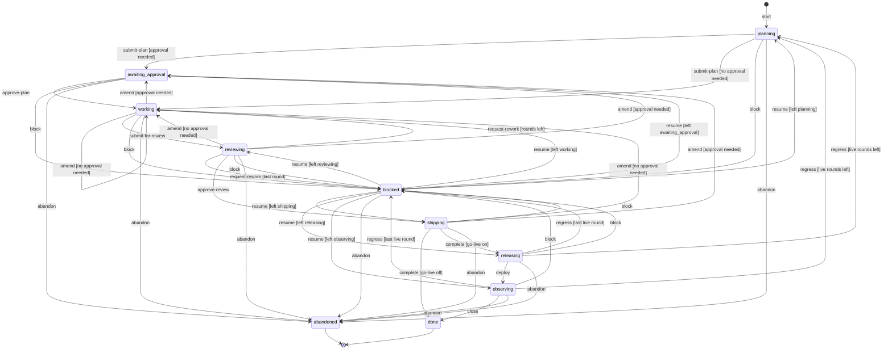
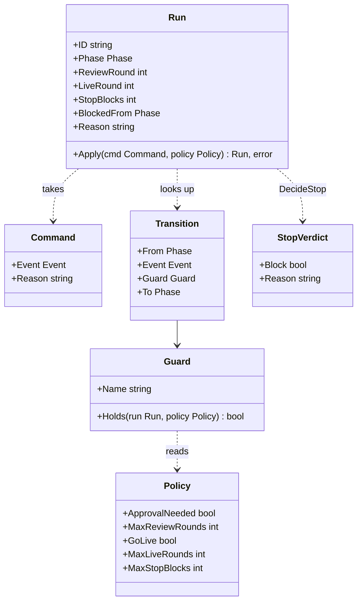
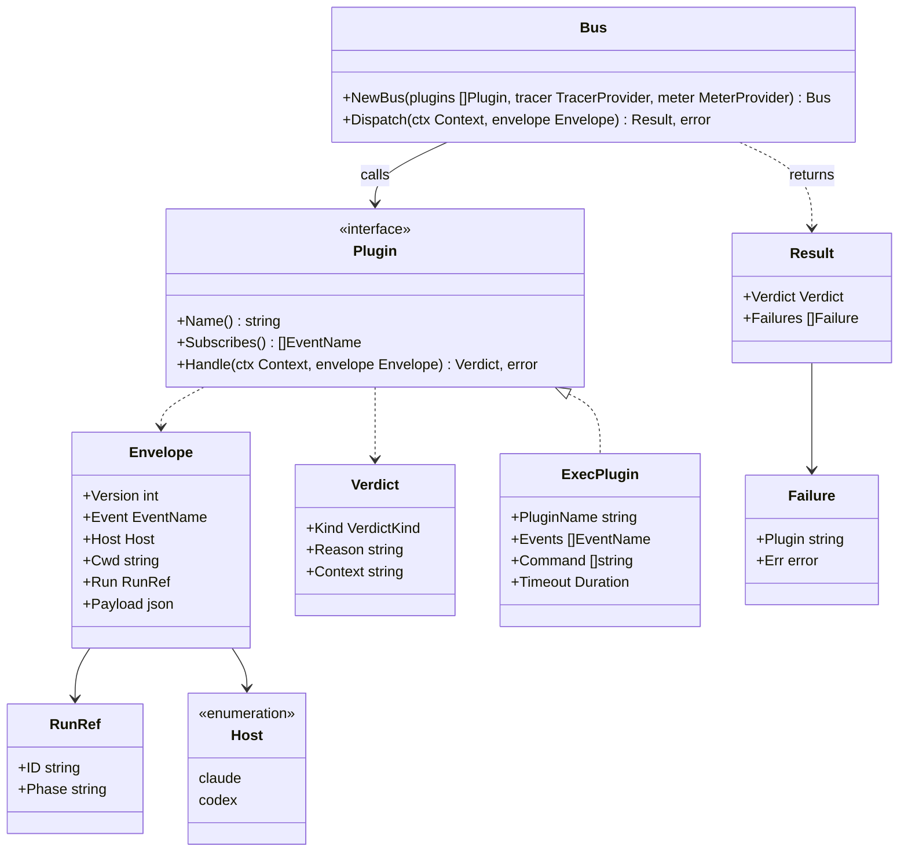
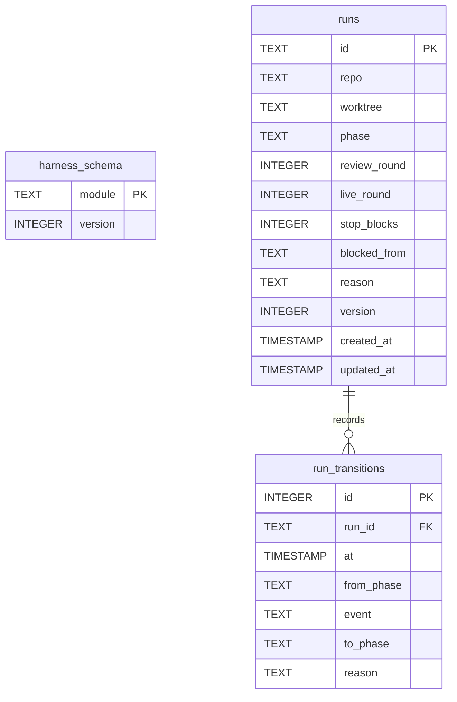
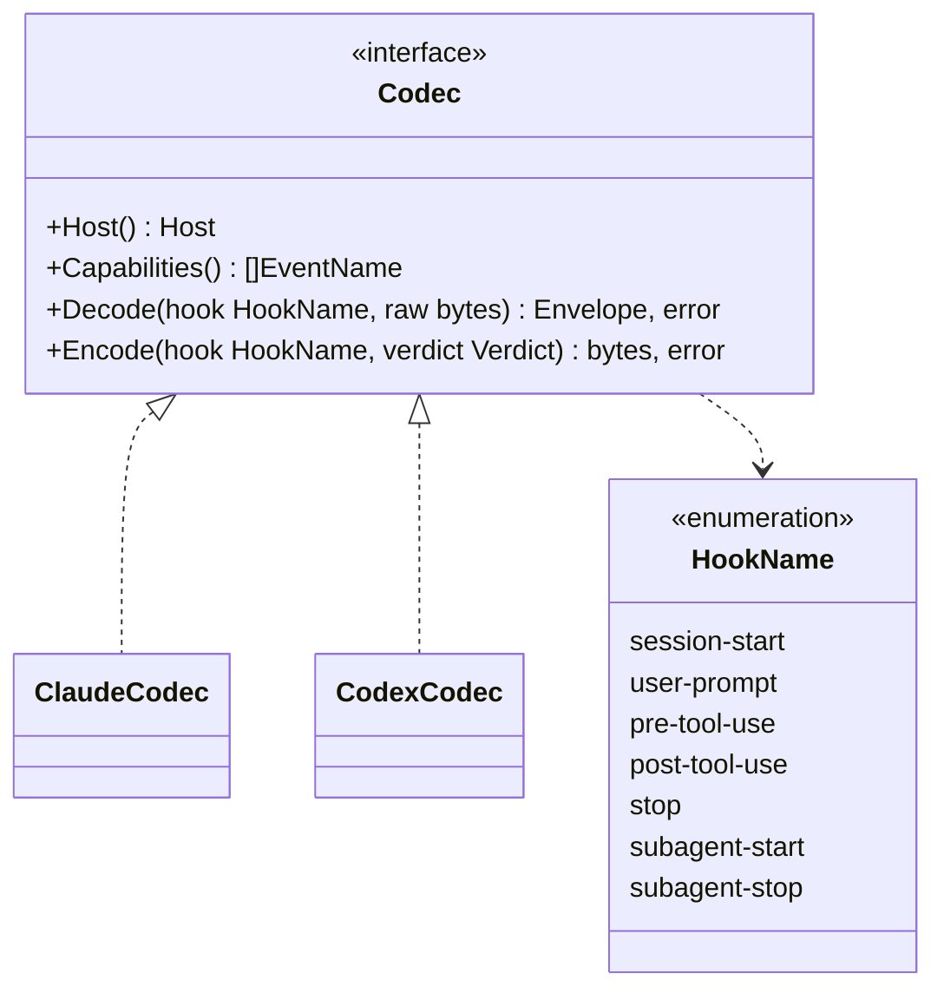

# Design

The harness is a Go binary that drives an AI coding agent through a deterministic loop. It plans, works, reviews, ships and watches production. Plugins can veto or extend each step.

## Modules

Each module is a bounded context under `internal/<module>/`. It has the layers `domain/`, `application/` and `infrastructure/`. Code that two modules use lives in `internal/shared/<layer>/`.

- A `module.go` file in each module is the only file that imports across its layers.
- `cmd/harness` wires the modules and holds no rule.
- A use case is `application/command/<name>/` or `application/query/<name>/`, with its message and its handler.
- A command handler returns only an error.
- A bus is not a use case. It lives in `application/<bus>/`.

`TestLayerImports` checks the direct imports of each package:

- A `domain` package imports only the standard library and `internal/shared/domain`.
- An `application` package imports no `go.opentelemetry.io/otel/sdk` package and no `infrastructure` package.
- A `ui` package imports no `infrastructure` package.

| Module | Path | Job |
|---|---|---|
| telemetry | `internal/shared/infrastructure/telemetry` | OpenTelemetry SDK setup, OTLP export, shutdown |
| run | `internal/run/domain` | Run aggregate, phases, guarded transitions, stop decision |
| shared bus | `internal/shared/{domain,application/eventbus,infrastructure/execplugin}` | Event catalogue, envelope, verdicts, event bus, exec adapter |
| dbal | `internal/shared/infrastructure/dbal` | Dialects, migrations, transactions, optimistic locks |
| run store | `internal/run/infrastructure/persistence` | `RunRepository` adapter on the DBAL |
| config | `internal/shared/infrastructure/config` | File, env and flags with viper |
| run use cases | `internal/run/application` | `harness run` commands and queries |
| plan | `internal/plan` | Plan parse and checks, plan view |
| host | `internal/host` | Claude Code and Codex hook codecs |
| guard | `internal/guard` | Built-in guard rules as in-process plugins on `tool.before` |
| gate | `internal/gate` | Verification gates from YAML, baseline ratchet, evidence |
| lint | `internal/lint` | Rule packs |
| live | `internal/live` | Merge and deploy records, signal checks, regression findings |

`ROADMAP.md` gives the pull request that builds each module.

## Loop

A run moves through phases. The transition table is deterministic: a row is `(from, event, guard) -> to`. The guards of one `(from, event)` pair exclude each other, so only one row applies.

`Policy.ApprovalNeeded` is computed for each call. The plan module sets it to false when the config turns approval off, or for a docs-only plan with no open question.

Each guard is a named pure function of the run and the policy:

| Guard | Holds when |
|---|---|
| `approval needed` | `policy.ApprovalNeeded` or `run.LiveRound > 0` |
| `no approval needed` | not `approval needed` |
| `rounds left` | `run.ReviewRound + 1 < policy.MaxReviewRounds` |
| `last round` | not `rounds left` |
| `go-live on` | `policy.GoLive` |
| `go-live off` | not `policy.GoLive` |
| `live rounds left` | `run.LiveRound + 1 < policy.MaxLiveRounds` |
| `last live round` | not `live rounds left` |
| `left` plus a phase | `run.BlockedFrom` is that phase |

A row with no guard always holds. The `approval needed` guard reads `LiveRound`. So each replan after a regression waits for approval, also when approval is off.

The diagram shows the table. In the diagram, `[*]` on the left is the phase none. The line `X --> [*]` marks a terminal phase with no outgoing row. A test compares the diagram with `domain.Transitions()`.



The effects of each event on the run, besides the phase:

| Event | Effect |
|---|---|
| any | `StopBlocks` goes to 0 |
| `approve-plan` | `ReviewRound` goes to 0 |
| `request-rework` into `working` | `ReviewRound` goes up by 1, `Reason` holds the findings |
| any event into `blocked` | `BlockedFrom` holds the old phase, `Reason` holds the reason or the findings |
| `resume` | `BlockedFrom` and `Reason` are cleared |
| `regress` into `planning` | `LiveRound` goes up by 1, `ReviewRound` goes to 0, `Reason` holds the regression findings |

The Go types are in `internal/run/domain`:

| File | Content |
|---|---|
| `phase.go` | `Phase`, one constant for each phase, `Phase.HoldsTheTurn()` |
| `event.go` | `Event`, one constant for each event of the diagram |
| `command.go` | `Command{Event, Reason}` |
| `policy.go` | `Policy{ApprovalNeeded, MaxReviewRounds, GoLive, MaxLiveRounds, MaxStopBlocks}` |
| `guard.go` | `Guard{Name, Holds}`, one variable for each guard |
| `transition.go` | `Transition{From, Event, Guard, To}`, `Transitions()` returns a copy of the table |
| `run.go` | `Run`, `Run.Apply(cmd, policy) (Run, error)` |
| `stop.go` | `StopVerdict{Block, Reason}`, `DecideStop(run, policy, agentRunning)` |
| `errors.go` | `ErrIllegalTransition`, wrapped with the phase and the event |

The caller gives `Run.ID`. A new run is `Run{ID: id}` in the phase none, and `start` moves it to `planning`.

`Phase.HoldsTheTurn` is true for `planning`, `working`, `reviewing` and `shipping`. The phases `releasing` and `observing` wait for production, so they do not hold the turn.

`DecideStop` blocks the end of an agent turn only when all three facts hold:

1. The phase holds the turn.
2. No agent runs.
3. `StopBlocks` is below `MaxStopBlocks`.

When it blocks, it returns the run with `StopBlocks` plus 1. The reason names the phase.



## Plugin events

A plugin is a building block. Built-in pieces and exec plugins implement the same `Plugin` port. The bus sends each event to the plugins that subscribe to it, in name order.

Event kinds:

- `veto`: a deny stops the dispatch and goes to the caller. The bus keeps the context texts. A plugin failure is a deny, so a veto fails closed.
- `collect`: the bus calls every plugin and joins all denies into one deny. It keeps the context texts. It reports plugin failures apart, and the caller decides.
- `context`: the bus keeps the context texts and drops a deny.
- `observe`: the bus drops every verdict.

| Event | Kind | Source |
|---|---|---|
| `session.started` | context | host hook |
| `prompt.submitted` | veto | host hook |
| `tool.before` | veto | host hook |
| `tool.after` | context | host hook |
| `turn.stopping` | veto | host hook |
| `subagent.started` | context | host hook |
| `subagent.stopped` | observe | host hook |
| `run.transition.before` | veto | run module |
| `run.transition.after` | observe | run module |
| `plan.submitted` | collect | plan module |
| `gate.before` | veto | gate module |
| `gate.after` | observe | gate module |
| `signals.check` | collect | live module |

A `signals.check` plugin reads one signal source, such as Prometheus or an OpenTelemetry backend. It denies on a breached threshold. The joined deny reasons become the regression findings.

The envelope goes to the plugin on stdin. Its version is 1.

```json
{"version":1,"event":"tool.before","host":"claude","cwd":"/repo","run":{"id":"r1","phase":"working"},"payload":{"tool":"Bash","input":{"command":"git push"}}}
```

The plugin writes the verdict on stdout. An empty stdout is an allow.

```json
{"verdict":"allow|deny|context","reason":"...","context":"..."}
```

Dispatch rules:

- `Dispatch(ctx, envelope)` returns `ErrUnknownEvent` before any call when the event is not in the catalogue.
- The bus calls the subscribed plugins one after the other, in name order.
- A deny reason in the result is the plugin name, `: ` and its reason. The bus joins several reasons with a newline.
- The bus joins context texts with a blank line.
- A `Failure` is `{Plugin, Err}`. On a veto event, a failure is a deny with the reason `plugin failed: ` plus the error.
- A verdict with a kind other than `allow`, `deny` or `context` is a failure.
- On a context or observe event, the result verdict is an allow.

The exec adapter `ExecPlugin{PluginName, Events, Command, Timeout}`:

- It runs `Command` with `exec.CommandContext`. The default timeout is 5 seconds. `WaitDelay` is 500 ms, because a child that keeps stdout open blocks `Wait` without it.
- It writes the envelope on stdin and reads the verdict from stdout.
- It runs the command in the envelope `cwd`, so a relative command such as `./scripts/gate.sh` works from any subfolder. A `cwd` that does not exist is a plugin failure.
- The plugin stderr goes to the harness stderr. The adapter keeps its last 512 bytes.
- A timeout, a non-zero exit or invalid JSON returns `ErrPluginFailed`, with the cause and the stderr tail.
- It injects the W3C trace context into the env var `TRACEPARENT`.



## Telemetry

OpenTelemetry is mandatory. Every command and hook starts the providers.

- `Setup(ctx, version) (shutdown, err)` installs one SDK `TracerProvider` and one `MeterProvider` as the global providers. It does this also when it returns an error.
- The resource has `service.name` `harness` and `service.version` from the argument.
- The traces exporter starts when `OTEL_EXPORTER_OTLP_ENDPOINT` or `OTEL_EXPORTER_OTLP_TRACES_ENDPOINT` is set. The metrics exporter uses `OTEL_EXPORTER_OTLP_METRICS_ENDPOINT` the same way.
- An endpoint without the `http` or `https` scheme is an error, and that signal gets no exporter.
- The exporters use OTLP over HTTP with protobuf. The other `OTEL_*` variables apply, such as the headers.
- Traces go through a batch span processor. Metrics go through a periodic reader. The shutdown flushes both.
- The exporters have retry off. `ShutdownTimeout` is 2 seconds, and `shutdown` uses one deadline for both providers.
- Only `infrastructure/` imports the SDK. Application code takes a `trace.TracerProvider` and a `metric.MeterProvider` of the API.

Signals of the plugin bus:

| Signal | Kind | Attributes |
|---|---|---|
| `plugin.call` | span | `harness.event`, `harness.plugin`, `harness.verdict` |
| `harness.plugin.duration` | histogram, unit `s` | `harness.event`, `harness.plugin`, `harness.verdict` |

- The value of `harness.verdict` is `allow`, `deny`, `context` or `failure`.
- The histogram buckets are 0.005, 0.01, 0.025, 0.05, 0.1, 0.25, 0.5, 1, 2.5, 5 and 10 seconds.
- The instrumentation scope is the import path of the eventbus package.

Later modules add a span for each run transition, gate, hook and live check.

## State

One abstraction keeps the run state, the run transitions and later the evidence. It is a small database abstraction layer (DBAL) with a SQLite default.

| Path | Content |
|---|---|
| `internal/shared/infrastructure/dbal/` | `DB`, `Open`, `InTx`, `Migrate`, the `Dialect` port, the SQLite dialect |
| `internal/run/domain/repository.go` | `RunKey`, the `RunRepository` port |
| `internal/run/domain/transitioned.go` | `Transitioned`, the event that `Apply` records |
| `internal/run/infrastructure/persistence/` | `SQLRunRepository` and the embedded migrations |

The DBAL API:

- `Open(ctx, dsn, baseDir)` reads the scheme of the DSN and picks the dialect. An unknown scheme returns `ErrUnknownEngine`. A DSN looks like `sqlite:.harness/state.db`.
- `InTx(ctx, fn)` commits when `fn` returns nil. It rolls back on an error or a panic.
- `Migrate(ctx, module, migrations)` applies the files of one module that are above its stored version.
- The `Dialect` port has `Engine`, `DriverName`, `DriverDSN` and `IsUniqueViolation`.
- The SQLite dialect uses the pure Go driver `modernc.org/sqlite`, so the binary needs no cgo. It sets WAL mode, a 5 second busy timeout and foreign keys, because hooks and subagents write in parallel.

Migrations:

- Each module embeds `migrations/<engine>/NNNN_name.sql`.
- The table `harness_schema` keeps one version for each module. `Migrate` creates it.
- `Migrate` applies each higher file in number order, each one in its own transaction with the version update.
- A file name that does not match `NNNN_name.sql` returns `ErrBadMigrationName` before any change.
- A remote engine ships its own migration folder, because the SQL differs.



A partial unique index `runs_one_active` on `(repo, worktree)` allows one active run for each worktree. A run is active when its phase is not `done` or `abandoned`.

The `RunRepository` port:

```go
type RunRepository interface {
	Active(ctx context.Context, key RunKey) (Run, error)
	Get(ctx context.Context, id string) (Run, error)
	Save(ctx context.Context, run Run) (Run, error)
}
```

- `Active` returns the active run of the key, or `ErrRunNotFound`. A shared database never mixes repos.
- `Save` with `Version` 0 inserts the run. A unique index violation returns `ErrActiveRunExists`.
- `Save` with `Version` above 0 updates the row `WHERE id = ? AND version = ?`. Zero changed rows return `ErrStaleRun`, so two sessions cannot overwrite one run.
- `Save` writes the run row and its `Transitioned` events in one transaction.
- `Apply` appends one `Transitioned{RunID, From, Event, To, Reason, At}` to the new run. The caller sets `Command.At`, so the domain reads no clock.

A contract test suite, `TestRunRepositoryContract`, runs for each dialect. A remote case skips when `HARNESS_TEST_<ENGINE>_DSN` is not set, so `make check` works offline.

## Config

`config.Load` reads the config with a new viper for each call. Only a command that needs config calls it, so `harness version` works outside a repo.

- The file is `.harness.yaml` at the git top level. The root flag `--config` names another file.
- A missing default file gives the defaults. A missing `--config` file is an error.
- The precedence is flag, then env, then file, then default. The env prefix is `HARNESS_`, and a dot becomes `_`: `HARNESS_STATE_DSN` sets `state.dsn`.
- The root flag `--state-dsn` binds to `state.dsn`.
- An unknown key is an error that names the key.

| Key | Default | Rule |
|---|---|---|
| `state.dsn` | `sqlite:.harness/state.db` | Not empty |
| `run.approval` | `true` | |
| `run.go_live` | `false` | The harness cannot know that a repo has a deploy |
| `run.max_review_rounds` | `3` | 1 or more |
| `run.max_live_rounds` | `3` | 1 or more |
| `run.max_stop_blocks` | `3` | 1 or more |
| `plugins` | empty list | A name, unique, a command, one event or more; `timeout` is a duration string of 0 or more, such as `750ms`, and 0 gives `5s` |
| `roles` | `explorer.claude: haiku`, `worker.claude: sonnet` | A role is `lead`, `worker`, `reviewer` or `explorer`; a host is `claude` or `codex` |

`execplugin.FromConfig` checks the plugin event names and builds the exec plugins. The host constants live in `internal/shared/domain`, so the envelope and the role table use one set.

`harness config` prints the effective config as YAML. Outside a git repo it writes `error: not in a git repository`.

Exit codes:

| Code | Cause |
|---|---|
| 0 | Success |
| 1 | A runtime error |
| 2 | A usage error: an unknown command, an unknown flag, a wrong argument count or a missing required flag. The usage text of the failing command follows the error |

## Run commands

`harness run <command>` drives the active run of the repo and the worktree. The run key is the normalized `origin` URL and the worktree top level.

| Command | Argument | Event |
|---|---|---|
| `start` | the prompt | `start` |
| `status` | none | none, a query |
| `plan` | none | `submit-plan` |
| `approve` | none | `approve-plan` |
| `amend` | none | `amend` |
| `review` | none | `submit-for-review` |
| `rework` | `--findings`, required | `request-rework` |
| `ship` | none | `approve-review` |
| `done` | none | `complete` |
| `block` | `--reason`, required | `block` |
| `resume` | none | `resume` |
| `abandon` | none | `abandon` |

Each command prints the run after its change on stdout:

```text
run 20261108-011805-add-the-login-page phase=working review_round=1 live_round=0
reason: the tests miss the empty case
next: implement test first, run harness verify, then harness run review
```

- The `reason:` line shows only when the reason is set.
- The `next:` hint is a constant map from the phase to text in `internal/run/ui/cli`. Each phase has one.
- With no active run, `status` prints `active: no` and exits 0. Each other command writes `error: run not found` and exits 1.
- An illegal transition, a veto, a stale run or an active run on `start` writes `error:` and the cause on stderr, and exits 1.
- A transition goes through `Flow.Move`: the span `run.transition`, `run.transition.before` (a deny vetoes), `Apply`, `Save`, then `run.transition.after`.

The `plan` and `amend` events go through the `PlanGate` port of the run domain. `Flow.Move` calls it after the legality check:

1. `Flow.Move` applies the event once to check that it is legal. An illegal event returns `ErrIllegalTransition` and never reaches the gate.
2. `PlanGate.Submit` checks `plan.md` of the run folder. A problem returns `ErrPlanHasProblems` with the problem lines, and the run stays in its phase.
3. It sends `plan.submitted`. A deny or a plugin failure returns `ErrPlanRejected` with the reasons, and the run stays in its phase.
4. It returns the plan track. `Apply` keeps the stricter of the run track and the plan track, so the track never goes down.

`cmd/harness` gives `run.NewModule` an adapter of the plan module as the `PlanGate`. The run context and the plan context never import each other.

The run folder is `.harness/runs/<run id>/` in the worktree top level. A human edits `plan.md` there. `start` does not create the folder.

The `plan.submitted` payload is `{"path": "<plan.md>", "track": "light|full"}`. The envelope `cwd` is the worktree and `run` holds the id and the phase.

The track comes from `Classify`. It is `full` when the code tree touches 3 or more folders, a `domain/` folder, a schema file, or a command or query folder. A `Track: full` line in `## Goal` raises it. A declared `light` never lowers it.

The state file is `.harness/state.db` in the git common dir, so each linked worktree shares it. The DBAL base dir is the common dir, and the default DSN `sqlite:.harness/state.db` is relative to it.

Only a `run` command and `plan check` load the config. Only a `run` command, and `plan check` without `--file`, open the store. `cmd/harness` gives `cli.NewCommand` a connect function, which returns `cli.Handlers{Key, Start, Transition, Status}`, built by `run.NewModule`. So `harness version` and `harness config` need no store.

`cmd/harness` wraps the `Args` of every command in a usage error, and a command with no `Args` takes none. A `run` command checks its required flag in its `Args` function, because cobra checks `MarkFlagRequired` after the `Args` step.

The `ui` layer: a `ui` package imports its own `application` and `domain` packages, and never an `infrastructure` package. `TestLayerImports` checks it.

## Plan commands

`harness plan check [--file path]` checks a plan in any phase, with or without a run.

- With `--file`, it checks that file with live round 0.
- Without `--file`, it checks `plan.md` in the run folder of the active run, with the live round of the run.
- It prints one problem on each stdout line, as `plan.md:12: rule: text`. A diagram of an unchecked kind prints `plan.md:30: note: diagram kind flowchart is not checked`.
- It exits 0 on a clean plan, and 1 when there is a problem or the file is unreadable.
- Without `--file` and with no active run, it exits 2 and prints the usage.
- The check records the span `plan.check` with `harness.plan.problems` and `harness.track`.

## Gates and lint packs

### Gates

A gate is one shell command that proves one property of the repo, such as the tests or the types. The `gate` module runs the gates and keeps their evidence.

The gates are the `gates` key of `.harness.yaml`:

| Field | Type | Rule |
|---|---|---|
| `id` | string | required, unique, matches `^[a-z][a-z0-9-]*$` |
| `run` | string | required, runs with `sh -c` in the repo root |
| `paths` | list of globs | optional, the files that the gate reads, empty means the whole tree |
| `timeout` | duration | optional, default `10m` |
| `baseline` | string | optional, the path of a committed baseline file |

```yaml
gates:
  - id: go-test
    run: go test ./...
    paths: ["**/*.go", "go.mod", "go.sum"]
  - id: lint
    run: harness lint --json
    baseline: .harness-baseline/lint.json
```

Input hash and evidence:

- `harness verify` writes the working tree into a temporary git index. The real index does not change.
- The input hash of a gate is the SHA-256 of the sorted path and blob hash pairs that match its `paths`. With no `paths`, it is the tree hash. So a docs change keeps the hash of `go-test`, and the gate does not run again.
- An evidence record is `{Repo, GateID, InputHash, Result, Duration, Tail, At}`. `Result` is `pass`, `fail` or `vetoed`. `Tail` holds the last 4 KiB of the output.
- The store keeps one record for each repo, gate and input hash.
- A `pass` record for the same key is reused: the gate is reported `cached`. A `fail` record is never reused.

Baseline ratchet:

- A gate with `baseline` reads its stdout as a findings report: `{"version":1,"findings":[{"rule","severity","file","line","message"}]}`.
- The key of a finding is its rule, its file and its message. A moved line is not a new finding.
- The gate fails only on an `error` finding whose key is not in the baseline file. A missing baseline file is an empty baseline.

Commands:

- `harness verify` runs the gates in file order. It prints `PASS`, `FAIL`, `VETOED` or `CACHED`, the id and the duration for each gate. It exits 1 when one gate fails.
- `harness verify --commits BASE` checks each commit of `BASE..HEAD` in a temporary detached worktree. A `test:` commit must fail one gate or more, and a later commit must pass. Every other commit must pass.
- `harness gates init` detects the toolchain (Go, pnpm, npm, Biome) and writes the `gates` key. It refuses to change an existing key.
- Before each gate that is not cached, the handler dispatches `gate.before` (veto). After each gate, it dispatches `gate.after` (observe).
- A built-in guard rule, `commits-checked`, denies `git push` and `gh pr create` without a passed commit check for the current `HEAD`.
- The `GateSource` port adds one gate for each criterion of the active plan, with the id `criterion-N`. Each criterion gets its own evidence record.

Before the review, an in-process plugin on `run.transition.before` verifies the trace of the plan against the branch. The pure function `VerifyTrace` checks these rules:

| Rule | The review is denied when |
|---|---|
| `tree-diff` | a tree mark does not match the diff: `new` is `A`, `changed` is `M`, `deleted` is `D` |
| `file-untracked` | a diff file is in neither final tree |
| `commit-missing` | the subject of a planned commit is not in `git log BASE..HEAD` |
| `commit-scope` | a commit touches a file outside the owned files of its tasks |
| `test-missing` | the test of a `Test first:` line is not in its file |
| `proof-missing` | the `criterion-N` evidence for its current input hash is missing or not `pass` |

### Lint packs

A lint pack is a set of rules with ids, an engine, a severity and a scope. The `lint` module runs the packs of `lint.packs` in `.harness.yaml`.

- Biome is the main engine. A custom rule is a GritQL plugin. Biome 2.0 or later is required.
- A rule that Biome cannot express runs on oxlint. Its pack file records the reason.
- The binary checks the folder layout and the import graph. These rules have the engine `harness`.
- The engine constants are `biome-grit`, `biome-rule`, `oxlint` and `harness`.
- Every GritQL message starts with the rule id in brackets, such as `[ddd/event-readonly]`.
- The severity is `error`, `warn` or `info`. Only an `error` finding fails the lint gate.
- The packs are embedded in the binary. `harness lint init` writes `.harness-lint/` into the repo, with one Biome config for each scope. The team commits it.
- `harness lint` stops with "run harness lint init" when `.harness-lint/VERSION` differs from the binary version.
- `harness lint --json` prints the findings report and always exits 0. The lint gate uses this form.
- `harness lint baseline` writes all findings when no baseline file exists. Else it only removes the keys that no longer match. It never adds a key.

| Pack | Needs | Content |
|---|---|---|
| `ddd` | none | Layout, layer direction, CQRS folders and handler pairs, domain purity, value object and event rules, in the NestJS style |
| `ddd-es` | `ddd` | Event sourcing rules |
| `observability` | none | Chart renders, probes, immutable image tags, HPA targets, tested alert rules |
| `nextjs` | none | Next.js App Router rules |
| `shadcn` | none | shadcn component rules |
| `nextjs-ddd-shadcn` | `ddd`, `nextjs`, `shadcn` | Combined layout |

A missing required pack is a config error.

## Go-live

Kodify stops at the pull request. The harness follows the run to production. The `live` module takes the run from the draft PR to a healthy release, or back to planning.

With `Policy.GoLive` on, `complete` moves the run to `releasing`. The merge and deploy records move it on. A regression in `releasing` or `observing` sends the same run back to `planning`. A repo with no deploy turns go-live off.

Release record: `{RunID, PRURL, MergeSHA, MergedAt, DeployedAt, Environment}`. `harness run done --pr URL` gives the PR URL.

Merge and deploy:

- The merge state comes from `gh pr view URL --json state,mergedAt,mergeCommit`.
- The deploy marker is the GitHub deployment status of the merge SHA in `live.environment` (default `production`). The newest status wins.
- `success` is a deploy. `failure` and `error` are a failed deploy. Other states are pending.
- A pipeline that deploys outside GitHub Actions writes the deployment status with one `gh api` call.

The plan has a `## Signals` table:

| Signal | Source | Query | Breach | Window | Panel |
|---|---|---|---|---|---|
| error rate | prometheus | `api:http_errors:ratio_rate5m` | `> 0.01` | 30m | https://grafana.example/d/api |

- `Breach` is an operator of `>`, `>=`, `<` or `<=`, then a number. `Window` is a Go duration.
- The watch window of a release is the longest window of its rows. It starts at `DeployedAt`.
- A `plan.submitted` plugin denies an invalid table. It also denies a plan that touches command, query, event handler or route code with no `## Signals` section.

For each row, the live check dispatches one `signals.check` collect event:

```json
{"signal":"error rate","source":"prometheus","query":"api:http_errors:ratio_rate5m","breach":{"op":">","value":0.01},"window":{"from":"2026-11-08T10:00:00Z","to":"2026-11-08T10:30:00Z"},"sha":"abc1234","environment":"production"}
```

- A plugin checks only the rows of its own `source`.
- A breach is a deny. The reason is the signal, the observed value, the operator and the threshold, for example `error rate 0.034 > 0.01`.
- A plugin failure means the check is not done. The release stays pending, and the next check tries again.

The live domain decides the outcome:

| Phase | Facts | Outcome | Run event |
|---|---|---|---|
| `releasing` | PR not merged, or deploy pending | `pending` | none |
| `releasing` | deploy failed | `regression` | `regress` with the deploy findings |
| `releasing` | deploy succeeded | `deployed` | `deploy` |
| `observing` | one breach or more | `regression` | `regress` with every breach |
| `observing` | no breach, no failure, window over | `healthy` | `close` |
| `observing` | no breach, window not over | `pending` | none |
| `observing` | only failures, more than one window after the window end | `unavailable` | `block` with "signals unavailable" |

The run guard turns `regress` into `blocked` on the last live round.

On a regression, the handler:

1. Applies `regress` through the run store. A stale version skips the run.
2. Archives `plan.md`, `review.md` and the review judgements as `plan-N.md`, `review-N.md` and so on. An existing archive stops the step.
3. Clears the submitted tree, the reviewed tree, the checked commits and the PR URL.
4. Gives the findings to the next agent session as the run reason. The agent replans with a `## Regression impact` section.

The findings text names the round, the PR, the SHA, each breach with its panel, and a rollback line from `live.rollback`. The harness never runs the rollback. The maintainer runs it.

`harness live check` checks every run of the repo in `releasing` or `observing`. It prints the id, the phase and the outcome for each run. A cron job or a CI schedule can run it. A `session.started` plugin also runs it when such a run exists.

## Hosts

The `host` module maps each host hook to a bus event, and each verdict back to the host output. One command handles every hook: `harness hook --host claude pre-tool-use`.

```go
type Codec interface {
    Host() shareddomain.Host
    Capabilities() []plugindomain.EventName
    Decode(hook HookName, raw []byte) (plugindomain.Envelope, error)
    Encode(hook HookName, verdict plugindomain.Verdict) ([]byte, error)
}
```

| Hook name | Claude Code hook | Codex hook | Bus event |
|---|---|---|---|
| `session-start` | `SessionStart` | `SessionStart` | `session.started` |
| `user-prompt` | `UserPromptSubmit` | `UserPromptSubmit` | `prompt.submitted` |
| `pre-tool-use` | `PreToolUse` | `PreToolUse` | `tool.before` |
| `post-tool-use` | `PostToolUse` | none | `tool.after` |
| `stop` | `Stop` | `Stop` | `turn.stopping` |
| `subagent-start` | `SubagentStart` | none | `subagent.started` |
| `subagent-stop` | `SubagentStop` | none | `subagent.stopped` |

Claude Code verdict output:

| Event and verdict | Output |
|---|---|
| any allow with no context | nothing |
| `tool.before` deny | `{"hookSpecificOutput":{"hookEventName":"PreToolUse","permissionDecision":"deny","permissionDecisionReason":"..."}}` |
| `prompt.submitted` or `turn.stopping` deny | `{"decision":"block","reason":"..."}` |
| context | `{"hookSpecificOutput":{"hookEventName":"...","additionalContext":"..."}}` |

Codex uses the same JSON shapes. Codex rejects a `Stop` hook that prints no JSON, so an allow on `stop` prints `{}`.

Capabilities and fallback:

- Each codec declares its events. Claude Code has all 7. Codex has 4.
- On `session-start`, the handler puts the missing events in the payload. It adds one context line for each, with the written fallback.
- On Codex, the adapter passes `agentRunning` false to `DecideStop`, because Codex reports no subagent stop.
- `harness host capabilities --host codex` prints the table, so a user sees the gap before a run.

The tool kind in the payload is `shell`, `edit`, `write`, `read`, `search`, `agent` or `other`. Claude Code `Bash` and Codex `shell` are `shell`. `Edit`, `MultiEdit` and Codex `apply_patch` are `edit`.

`harness hook` rules:

- It reads stdin up to 16 MiB, dispatches on the bus, encodes the verdict and always exits 0.
- A harness error on a veto event fails closed: the output is a deny with the reason `harness error: ` and the error.
- A harness error on another event writes one stderr line and prints nothing, or `{}` for a Codex `stop`.

`harness host install --host H` merges the hook template into `.claude/settings.json` or `.codex/hooks.json`. It keeps every other key and every hook that is not from the harness. A second run changes nothing.



## Differences from kodify

These kodify issues are fixed in the new design. `ROADMAP.md` names the pull request that fixes each one.

| Id | Kodify | Harness |
|---|---|---|
| K1 | Several target phases for one phase and event | The table has guards, and a test proves that one guard holds |
| K2 | No extension point: a new guard rule edits 4 files | A guard rule is a plugin with one registration |
| K3 | The DDD lint lives inside the guard context | `lint` is its own module, and the guard only calls it |
| K4 | Only the last evidence, in one file | The evidence store keeps one record for each gate input hash |
| K5 | Agent names and models are hardcoded in Go | A role table in config maps each role to a model for each host |
| K6 | `profiles/musts.yaml` is read by no Go code | Gates and lint packs are data that the binary reads |
| K7 | A Node script parses mermaid | The diagram check is in Go, with no Node dependency |
| K8 | Review proofs are skipped on Codex in silence | Each host declares its capabilities, and a missing proof is visible |
| K9 | Company parts: NATS, feedback ledger, Alabama compliance, `gmsllc` releases, `tf.sh` wrapper | The core has none of them |
| K10 | The track is not persisted | The run keeps its track, and the stricter track wins |
| K11 | The run ends at the PR, so production signals never return to the loop | `releasing` and `observing` close the loop |
| K12 | One tracer provider for each span, no metrics, no telemetry API for modules | One provider for each process, a meter, and the API in application code |
| K13 | A plan that changed in `awaiting_approval` cannot be checked before the approval | `harness plan check` checks a plan in any phase |
| K14 | State in JSON files under a file lock, on one machine | A DBAL with embedded SQLite, and remote engines can follow |
| K15 | `plan.html` loads mermaid from a CDN and links no criterion to its tasks, specs, tests or files | The page is self-contained and links them all |
| K16 | The review checks only the final trees | The review verifies every link of the trace: proofs, tree marks, commits, owned files and tests |
