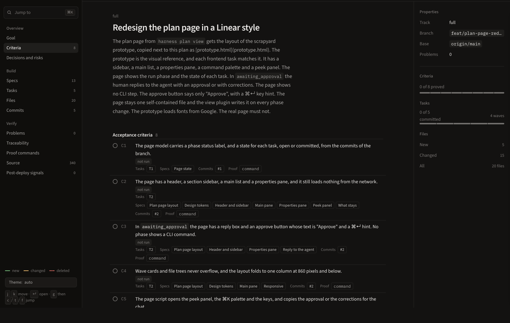
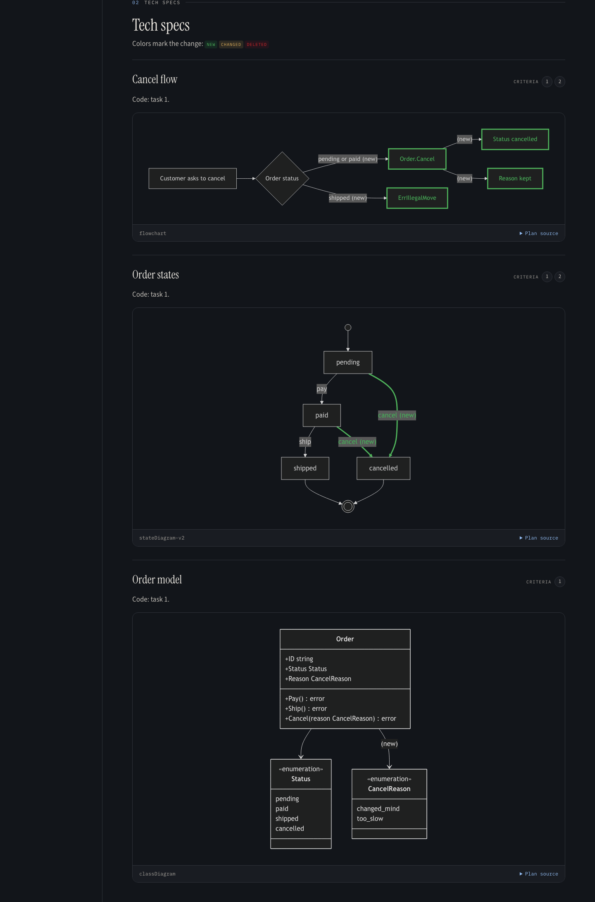
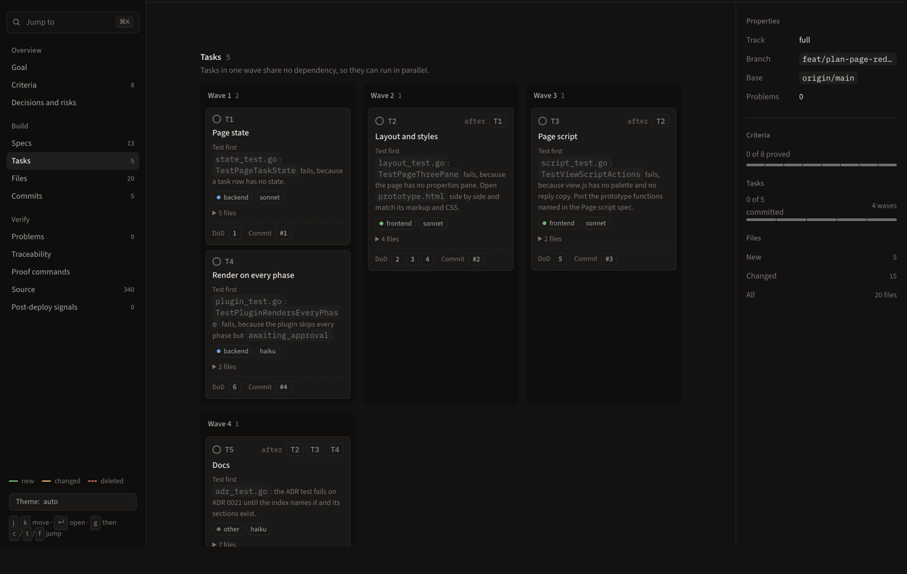

# harness

The harness is an open source Go tool and a plugin for Claude Code and Codex. It drives an AI coding agent through a fixed loop: plan, approve, work, review, ship and watch production.

Status: pre-alpha.

## Install

The harness is a plugin for Claude Code and for Codex. The plugin installs these parts:

- The skills `harness` (the loop), `pr-open` (the pull request of the ship step), `lint-setup` (the architecture rules of a project), `ddd` (the DDD layout that the lint packs check), `demo` (a watched browser walkthrough) and `report` (a bug about the harness).
- The agents are `explorer` (the facts for a plan), `advisor` (the check of a plan) and `worker` (one task of a plan, or a fix). The others are `reviewer` (one lens of a run review), `verifier` (the findings of a round) and `linter` (the lint setup).
- The hooks of the host. They act only in a git repository with `.harness.yaml` at its top level.

The plugin downloads its own binary with `curl` or `wget`, but puts no `harness` command on the `PATH`. Install one as in [the harness command](#the-harness-command). See [the plugin binary](docs/setup.md#the-plugin-binary) for the download and build rules.

### Claude Code

```text
/plugin marketplace add 90p-labs/harness
/plugin install 90p@harness
```

From a shell, run `claude plugin marketplace add 90p-labs/harness` and `claude plugin install 90p@harness`. Then run `/reload-plugins` or start a new session. To move from the old plugin name, see [the move](docs/setup.md#move-from-the-old-plugin-name).

### Codex

```sh
codex plugin marketplace add 90p-labs/harness
codex plugin add 90p@harness
```

Open `/hooks` in Codex once and trust the harness hooks. Codex does not run a plugin hook that you did not trust.

### The harness command

Download the binary of the latest release into a folder on the `PATH`. Pick `darwin-arm64`, `darwin-amd64`, `linux-amd64` or `linux-arm64` at the end of the URL.

```sh
curl -fsSL -o ~/.local/bin/harness https://github.com/90p-labs/harness/releases/latest/download/harness-darwin-arm64 && chmod +x ~/.local/bin/harness
```

For a given release, write `download/v0.5.0` in place of `latest/download`. With `wget`, write `wget -qO` in place of `curl -fsSL -o`. To build from source with Go 1.27, see [docs/setup.md](docs/setup.md#build-from-source).

## Set up a repository

In your repository, run `harness gates init`. It detects the gates and writes the `gates` key of `.harness.yaml`. `harness run start` adds `.harness/runs/` to `.gitignore` when the line is missing. Then commit the files.

```console
$ harness gates init
go-fmt: test -z "$(gofmt -l .)"
go-vet: go vet ./...
go-test: go test ./...
```

With no detected toolchain, run `harness recipe apply <name>` with one of the recipes `go`, `nextjs`, `python` or `symfony`. It writes only the missing files. Or write the `gates` key by hand, as in [docs/setup.md](docs/setup.md) and [examples/](examples/). The lint packs call Biome and oxlint: `npm i -g @biomejs/biome@2.6.6 oxlint@1.92.0`.

Without the plugin, `harness init --host claude` (or `--host codex`) writes the gates, the lint files and the baseline, installs the hooks, and adds `.harness/runs/` to `.gitignore`. Do not use it with the plugin, or each hook runs twice. [`docs/configuration.md`](docs/configuration.md) explains every config key.

## Usage

### Your first run

This walkthrough follows one real request in a small Go shop. An order there moves from `pending` to `paid` to `shipped`. You type one line, answer the questions, read one page and merge one pull request.

**1. Ask for the change.** In Claude Code, type the line below. In Codex, start it with `$90p:harness` instead.

```text
/90p:harness Let a customer cancel an order before it ships
```

**2. The agent plans.** It reads the code and writes `plan.md` with the criteria, the diagrams and the tasks. You wait. The agent runs these commands, and this is their real output:

```console
$ harness run start "Let a customer cancel an order before it ships"
run 20261111-100957-let-a-customer-cancel-an-order-before-it phase=planning review_round=0 live_round=0
models: lead=opus explorer=haiku worker=sonnet,haiku reviewer=sonnet,haiku,opus advisor=fable,opus
$ harness plan check
plan.md:99: note: diagram kind sequenceDiagram is not checked
advisor: on, model fable
wave 1: task 1 (haiku)
wave 2: task 2 (sonnet)
wave 3: task 3 (sonnet)
$ harness run plan
run 20261111-100957-let-a-customer-cancel-an-order-before-it phase=awaiting_approval review_round=0 live_round=0
```

**3. Read the plan.** `harness plan view` writes the plan as one page, and the page updates on every phase change. First, check that each criterion says what you want. Criterion 2 says that a shipped order refuses the cancel:



Then check that the diagrams match your model. The new cancel path is in green:



Last, look at the order of the work. Each task starts with a failing test and names its model:



**4. Answer and approve.** The agent asks about each open decision. In this plan, the decision was that a cancel does not refund a paid order. Then it asks the `Plan` question with `Approve` and `Change the plan`. Your code does not change before you pick `Approve`. To let a model approve instead, run `harness run approve --by <model> --reason "<one line>"`.

**5. Let it work.** You do nothing in this step. A worker takes each task in wave order, commits the failing test, then the code. `harness verify` runs the gates and the 4 criteria. On the full track, two or more models review the change, a verifier checks each finding, and a worker fixes the real ones. A light track with no guard, security or hook path gets one reviewer and no verifier.

**6. Merge the pull request.** By default the agent opens a draft and stops. Only you can merge it, because the guard denies a merge. `guard.disabled` can let the agent mark it ready and merge. Run `harness pr policy` to see which. After the merge, the agent closes the run with `harness run done --pr <url>`.

**7. Watch production (optional).** With `run.go_live: true`, the run follows the deploy of your merge. `harness live check` then watches the `## Signals` rows of the plan:

| Signal | Breach | Window |
|---|---|---|
| cancel error rate | `> 0.01` | 30m |
| cancel after ship | `> 0` | 1h |

A healthy hour closes the run. A breach sends the run back to `planning` with the findings, and the harness never rolls back for you. [docs/go-live.md](docs/go-live.md) covers the setup, and [docs/runs.md](docs/runs.md) shows a full run.

### Everyday commands

| Command | What it does |
|---|---|
| `/90p:harness <prompt>` | Start a run |
| `/90p:harness status`, `approve`, `abandon` | Show the run, approve the plan, or abandon the run |
| `harness run status`, `harness run report` | Print the phase, or the rework rounds, the stop blocks and the trace ID |
| `harness plan view` | Write the plan as an HTML page |
| `harness verify` | Run the gates and the acceptance criteria |
| `harness verify --commits main` | Check each commit of the branch |
| `harness pr body`, `harness pr check --body-file <path>`, `harness pr policy` | Print a PR body skeleton, every problem of a PR body, or the draft and merge policy |
| `harness lint`, `harness config` | Run the lint packs, or print the effective config |
| `/90p:report` | File a bug about the harness |

## Goals

An agent should not merge what you did not approve, or claim what it did not prove. Each goal maps to one part of the harness:

- **You approve the plan first.** The plan holds the goal, the criteria, the diagrams and the tasks. The agent starts work only after your answer.
- **Proof, not claims.** A gate is one shell command that proves one property, such as the tests. `harness verify` runs the gates and each criterion, and keeps the evidence.
- **Tests before code.** A `test:` commit must fail a gate, and every other commit must pass.
- **More than one reviewer.** Two or more models review the change, and a verifier checks each finding. A light track with no guard, security or hook path gets one reviewer, and the floor is 1 model.
- **Hard limits.** The guard rules run on the host hooks. They deny a PR merge, a PR that is not a draft, a forced push, a read of a secret and an early stop. `guard.disabled` can turn off the two PR rules, see `harness pr policy`.
- **Clean architecture.** Lint packs for DDD, event sourcing, observability, Next.js and shadcn, with a baseline ratchet.
- **Open to your tools.** An exec plugin reads a JSON event on stdin and prints a verdict. It can veto a transition, a plan or a gate.

## Phases

A run moves through fixed phases. Each move is one row of a transition table in `internal/run/domain`, and a plugin can veto it. A run can also go to `blocked` (for example after the last review round) or `abandoned`. [docs/runs.md](docs/runs.md#run-phases) has the full state diagram and a full run with its output.

| Phase | What happens | Next |
|---|---|---|
| `planning` | The explorer reads the code, the agent writes `plan.md`, and the advisor checks it | `harness run plan` |
| `awaiting_approval` | The agent asks you the open questions, then the `Plan` question | `harness run approve` |
| `working` | Workers write the tests first, then the code, and `harness verify` runs the gates | `harness run review` |
| `reviewing` | The reviewers check the change and a verifier checks each finding | `harness run ship` or `harness run rework` |
| `shipping` | The agent reads `harness pr policy` and opens the pull request: a draft you merge by default | `harness run wait --pr URL`, then `harness run done --pr URL` |
| `releasing`, `observing` | With go-live on, the run follows the deploy and the signals | `harness live check` |
| `done` | The run is closed | `harness run start` |

## Extend it per project

The binary is the same in every repository. Each project plugs in its own tools through the `plugins` key of `.harness.yaml`, with no change to the harness. A plugin is any command, often a short shell script. It reads a JSON event on stdin and prints a verdict on stdout. The events that it lists decide what it extends:

| Event | What the plugin adds | Example |
|---|---|---|
| `gates.detect` | Gates read from the build files of the project | [`examples/symfony/`](examples/symfony/) turns the `## gate` targets of a Makefile into gates |
| `lint.check` | A native lint tool, run as a lint engine | [`examples/go/`](examples/go/) runs go-arch-lint, [`examples/python/`](examples/python/) runs ruff and import-linter, and [`examples/symfony/`](examples/symfony/) runs deptrac |
| `plan.submitted`, `run.transition.before` | A team rule that can veto a plan or a phase move | [`docs/plugins.md`](docs/plugins.md#hook-plugin) refuses a plan with no risks section |
| `signals.check` | Production signals after the deploy | [`docs/plugins.md`](docs/plugins.md#signals-plugin) sends the run back to planning on a breach |

The Python example declares its ruff plugin in five lines:
```yaml
plugins:
  - name: ruff
    command: [sh, .harness/plugins/ruff-lint.sh]
    events: [lint.check]
    timeout: 60s
```

[`examples/nextjs/`](examples/nextjs/) needs no plugin, because the built-in lint packs cover Next.js and shadcn. [`examples/README.md`](examples/README.md) compares the four projects, and [`docs/plugins.md`](docs/plugins.md) gives the contract and each plugin kind.

## Documents

- [`docs/setup.md`](docs/setup.md): the plugin binary, the lint tools, `harness init` and the step by step setup.
- [`docs/configuration.md`](docs/configuration.md) and [`docs/configuration-full.md`](docs/configuration-full.md): every key of `.harness.yaml`, and one example for each case.
- [`docs/runs.md`](docs/runs.md): a full run, the plan view, the multi-run plan and the run phases.
- [`docs/plugins.md`](docs/plugins.md): the plugin contract and the five plugin kinds.
- [`docs/go-live.md`](docs/go-live.md): follow a run from the merge to production.
- [`examples/README.md`](examples/README.md): four example projects in Go, Next.js, Python and Symfony, with their gates and lint packs.
- [`docs/contributing.md`](docs/contributing.md): the repository layout, the tests and the bug report.
- [`DESIGN.md`](DESIGN.md), [`CONTEXT.md`](CONTEXT.md), [`ROADMAP.md`](ROADMAP.md) and [`docs/adr/`](docs/adr/): the design, the terms, the build order and the decisions.

## License

MIT. See `LICENSE`.
