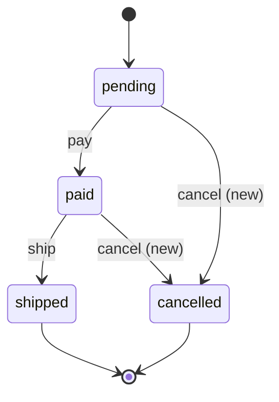
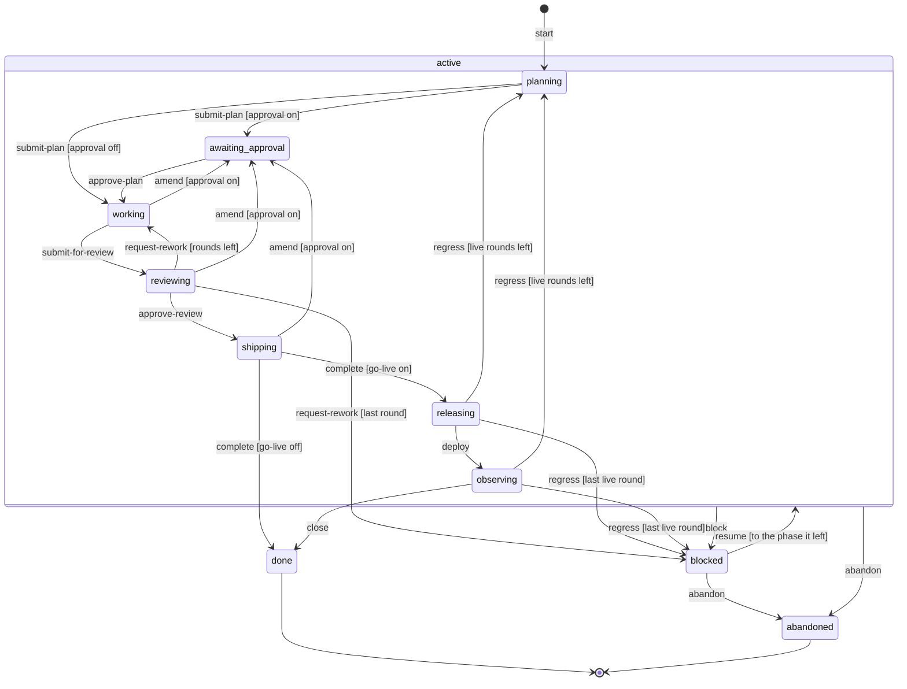

# harness

The harness is an open source Go tool that drives an AI coding agent through a fixed loop: plan, work, review, ship and watch production. It works with Claude Code and Codex. It has five parts:

- **Run loop.** A run moves through fixed phases. Each move is one row of a transition table, and a plugin can veto it. `harness run` drives the run.
- **Gates.** A gate is one shell command that proves one property of the repo, such as the tests. `harness verify` runs the gates and the acceptance criteria of the plan, and keeps the evidence.
- **Lint packs.** Rule packs for DDD, event sourcing, observability, Next.js and shadcn, on Biome, oxlint and a built-in engine, with a baseline ratchet.
- **Guard.** Built-in rules on the host hooks. They deny a PR merge, a PR that is not a draft, a forced push, a read of a secret, a push before a commit check, and a stop while the run holds the turn.
- **Exec plugins.** Any command that reads a JSON event on stdin and prints a verdict. A plugin can veto a transition, a plan or a gate, propose gates, add lint findings, report a signal breach, or add context for the agent.

Status: pre-alpha.

## Install

The harness is a plugin for Claude Code and for Codex. The plugin installs the skill `harness`, the agent `reviewer` and the hooks of the host. The hooks act only in a git repository with `.harness.yaml` at its top level. In any other folder, they do nothing.

The repository is private. Log in to GitHub once, so that the host can clone the plugin and the plugin can download the binary:

```sh
gh auth login
gh auth setup-git
```

The plugin starts the binary through `bin/harness`, which runs `dist/harness-OS-ARCH` of the plugin folder. When that binary is missing:

- A command downloads the binary of release `v<plugin version>` with `gh`. Without `gh`, or when the download fails, it builds the binary with Go. Without both, it exits 127 and names the fix.
- A hook never builds, because it must not block the session. It starts the `gh` download in the background and skips itself. A skipped hook prints `{}`, so the guard is off until the binary is there. When the download fails, the next hooks print its error, and a hook tries again after 10 minutes.
- On a machine with Go and no `gh`, start `/harness:harness status` once (Codex: `$harness:harness status`). The skill runs `bin/harness version`, which builds the binary.

The plugin puts no `harness` command on the `PATH`. The setup commands below and a gate such as `harness lint --json` need one: build it from source, or download the asset `harness-OS-ARCH` of release `v<plugin version>` (`gh release download v<plugin version> -R jorge07/harness -p harness-OS-ARCH`), make it executable and put it on the `PATH` as `harness`.

Do not also run `harness host install` in a repository where you use the plugin: each hook then runs twice.

### Claude Code

```text
/plugin marketplace add jorge07/harness
/plugin install harness@harness
```

From a shell, the same steps are `claude plugin marketplace add jorge07/harness` and `claude plugin install harness@harness`. Then run `/reload-plugins` or start a new session. Start a run with `/harness:harness <prompt>`.

### Codex

```sh
codex plugin marketplace add jorge07/harness
codex plugin add harness@harness
```

Open `/hooks` in Codex once and trust the harness hooks. Codex does not run a plugin hook that you did not trust. Start a run with `$harness:harness <prompt>`.

### Build from source

Use this path for a repository without the plugin, or to put `harness` on the `PATH`. The harness needs Go 1.27 (see `go.mod`):

```sh
git clone https://github.com/jorge07/harness.git
cd harness
go install ./cmd/harness   # into $(go env GOPATH)/bin
make build                 # or: go build -o dist/harness ./cmd/harness
make check                 # gofmt, go vet and go test
./dist/harness version
```

Without the plugin, `harness init` below writes the hooks into the repository.

## Set up a repository

The lint packs call external tools. Put them on the `PATH`:

| Tool | Version | Needed for |
|---|---|---|
| Biome | 2.0 or later (CI pins 2.6.6) | the packs `ddd`, `ddd-es`, `nextjs` and `shadcn` |
| oxlint | CI pins 1.92.0 | the two oxlint rules of the pack `nextjs` |
| helm, promtool | any | the chart rules of the pack `observability`, and the `helm-render` and `promtool-test` gates of the default deploy plugins |

```sh
npm i -g @biomejs/biome@2.6.6 oxlint@1.92.0
```

The config is `.harness.yaml` at the git top level. Run the commands below from the repository root.

### With harness init (no plugin)

`harness init` always installs the hooks of the host. With the plugin, each hook then runs twice: use the step by step setup below.

`harness init --host claude` (or `--host codex`) sets up the repository in one step. It keeps `lint.packs`, or it chooses the packs from the repository files: `next` or `@nestjs/core` in `package.json` give `nextjs` or `ddd`, and `components.json` gives `shadcn`. Then it writes the gates, the lint files and the lint baseline, and installs the hooks. On a NestJS repository with the scripts `typecheck` and `test`:

```console
$ harness init --host claude
lint packs: wrote ddd
gates: wrote node-typecheck, node-test, lint
lint init: wrote .harness-lint
lint baseline: wrote .harness-baseline/lint.json
host: wrote /home/dev/shop/.claude/settings.json
```

A second run keeps `lint.packs` and the `gates` key, and the other steps are safe to repeat. With no pack, it skips the baseline. When it chooses packs but the `gates` key exists, it stops before it writes: set `lint.packs` and the `lint` gate by hand, or remove the `gates` key. Without a lint engine on the `PATH`, it stops at the baseline step: install the engine and run it again. After a full run, do step 5 below.

### Step by step

1. Set the lint packs first, if you use them, for example `lint: {packs: [ddd]}`. `gates init` adds the lint gate only when `lint.packs` is set.
2. Run `harness lint init` to write the engine files of the packs into `.harness-lint/`. Run `harness lint` to see the findings, and `harness lint baseline` to record them as the baseline. The lint gate fails only on a new `error` finding. A later `harness lint baseline` only removes the keys that no longer match, so the baseline only shrinks.
3. Run `harness gates init` to detect the gates. It reads the toolchain (Go, pnpm, npm, Biome) and the deploy plugins, and writes the `gates` key. It refuses to change an existing key.
4. Skip this step when you use the plugin: the plugin installs the hooks. Else run `harness host install --host claude` (or `--host codex`). It merges the hooks into `.claude/settings.json` or `.codex/hooks.json` and keeps every other key. `harness host capabilities --host codex` prints each host event and whether the host supports it.
5. Commit `.harness.yaml`, `.harness-lint/`, `.harness-baseline/` and the host config, if you wrote one. Add `.harness/` to `.gitignore`: it holds the run folders.

An example `.harness.yaml`. `harness config` prints the effective config, and an unknown key is an error:

```yaml
git:
  default_branch: main
run:
  approval: true          # wait for a human approval of each plan
  max_review_rounds: 3    # the last allowed rework blocks the run
roles:
  reviewer:
    claude: opus          # the guard denies an agent call on another model
lint:
  packs: [ddd]
verify:
  parallel: 3             # at most 3 gates at the same time; the default 1 runs them in file order
setup:
  - id: go-mod
    run: go mod download
    paths: [go.mod, go.sum]  # runs again only when these files change
gates:
  - id: go-fmt
    run: test -z "$(gofmt -l .)"
    paths: ["**/*.go"]
  - id: go-vet
    run: go vet ./...
  - id: lint
    run: harness lint --json
    baseline: .harness-baseline/lint.json
  - id: go-test
    run: go test ./...
    paths: ["**/*.go", go.mod, go.sum]   # a docs change does not run the gate again
    needs: [go-fmt, go-vet, lint]        # starts only when each need is PASS or CACHED
  - id: e2e
    run: make e2e
    needs: [go-test]
```

`harness verify` runs `go-mod` before the gates, and only when `go.mod` or `go.sum` changed since its last pass. A setup step has no evidence and no `needs`, and a failed step stops `harness verify` before any gate. `go-fmt`, `go-vet` and `lint` run in parallel. When `lint` fails, `go-test` and `e2e` do not run, and `harness verify` exits 1:

```text
PASS go-fmt 61ms
PASS go-vet 1.4s
FAIL lint 812ms
SKIPPED go-test needs lint
SKIPPED e2e needs go-test

lint:
<the last 4 KiB of the lint output>
```

`DESIGN.md` lists every config key, every event and every guard rule.

## Plugins

A plugin is a command in the `plugins` key. The harness writes the event envelope as JSON on stdin and reads one verdict from stdout: `{"verdict":"allow|deny|context","reason":"...","context":"...","findings":[]}`. An empty stdout is an allow, and a non-zero exit is a plugin failure. The default `timeout` is 5 seconds. [`DESIGN.md`](DESIGN.md#plugin-events) gives the full contract: each event, its kind and its payload. The output below is real, from scratch repositories. Two scripts need `jq`.

### Deploy tool plugin

A deploy tool plugin answers `gates.detect` with the gates that it proposes, one JSON gate on each line of `context`. `harness gates init` and `harness init` append them. `scripts/kubeconform-detect.sh` proposes a kubeconform gate when the repository has files in `deploy/manifests/`:

```sh
#!/bin/sh
if grep -q '"deploy/manifests/'; then
  echo '{"verdict":"allow","context":"{\"id\":\"kubeconform\",\"run\":\"kubeconform -summary deploy/manifests\",\"paths\":[\"deploy/manifests/**\"]}"}'
fi
```

```console
$ cat .harness.yaml
plugins:
  - {name: kubeconform, command: [sh, scripts/kubeconform-detect.sh], events: [gates.detect]}
$ harness gates init
helm-render: helm template deploy/chart > /dev/null
kubeconform: kubeconform -summary deploy/manifests
```

The default plugin `helm` proposed `helm-render` for `deploy/chart/Chart.yaml`. `deploy.disabled` turns off a default plugin, `helm` or `promtool`. With `deploy: {disabled: [helm]}`, the same command proposes only the kubeconform gate.

### Custom lint pack and lint engine plugin

An entry of `lint.packs` with a `/` is a custom pack: a folder with a `pack.yaml`. A rule names its engine: `biome-grit`, `biome-rule`, `oxlint` or a lint plugin. [`DESIGN.md`](DESIGN.md#custom-packs) gives the GritQL rules and the other keys. A lint engine plugin answers `lint.check`. The payload holds the rules of its engine and the files that match their scopes. The findings of the verdict go through the same report, baseline ratchet and lint gate as the built-in rules. `scripts/console-lint.sh`:

```sh
#!/bin/sh
jq -j '.payload.files[] + "\u0000"' | xargs -0 grep -IHn 'console\.log' /dev/null |
  jq -Rn '{verdict: "allow", findings: [inputs | split(":") | {rule: "team/no-console", file: .[0], line: (.[1] | tonumber), message: "console.log in source"}]}'
```

```console
$ cat lint/team/pack.yaml
name: team
rules:
  - id: team/no-console
    engine: console-lint
    severity: error
    scope: "src/**/*.ts"
    message: A source file calls console.log. Use the logger.
$ cat .harness.yaml
lint: {packs: [./lint/team]}
plugins:
  - {name: console-lint, command: [sh, scripts/console-lint.sh], events: [lint.check], timeout: 30s}
$ harness lint init
$ harness lint
error team/no-console src/checkout.ts:2 console.log in source
error: lint found error findings
```

Run `harness lint init` after each edit of a custom pack. A finding takes the severity of its rule. `lint.disabled` turns off a default engine, `harness`, `biome-grit` or `oxlint`, and the rules of that engine then do not run: for example, `lint: {disabled: [biome-grit]}`.

### Signals plugin

In `observing`, `harness live check` sends one `signals.check` event for each row of the `## Signals` table of the plan. A plugin answers only the rows of its own `source`, and a breach is a deny. [`docs/go-live.md`](docs/go-live.md) gives the table, the payload and the verdict. `scripts/prom-check.sh` reads the value of the query at the check time from `$PROMETHEUS_URL`, which must be set where `harness live check` runs. A failed read is a plugin failure:

```sh
#!/bin/sh
row=$(jq -c .payload)
[ "$(echo "$row" | jq -r .source)" = prometheus ] || exit 0
value=$(curl -sfG "$PROMETHEUS_URL/api/v1/query" --data-urlencode "query=$(echo "$row" | jq -r .query)" | jq -er '.data.result[0].value[1]') || exit 1
echo "$row" | jq --argjson v "$value" '.breach as $b | select({">": ($v > $b.value), ">=": ($v >= $b.value), "<": ($v < $b.value), "<=": ($v <= $b.value)}[$b.op]) | {verdict: "deny", reason: "\(.signal) \($v) \($b.op) \($b.value)"}'
```

The `plugins` entry is `{name: prom, command: [sh, scripts/prom-check.sh], events: [signals.check]}`. In this scratch run, a stub `gh` gave the merge and the deploy, and the first check moved the run to `observing`. On the next check, the breach sends the run back to `planning` with the findings:

```console
$ harness live check
20261108-161558-let-a-customer-cancel-an-order observing regression
$ harness run status
run 20261108-161558-let-a-customer-cancel-an-order phase=planning review_round=0 live_round=1
reason: Regression in live round 1 of run 20261108-161558-let-a-customer-cancel-an-order: PR https://github.com/acme/orders/pull/7, sha 4f2a9c1, production.
- prom: error rate 0.034 > 0.01, window 30m, panel https://grafana.example/d/orders
...
```

### Hook plugin

A hook plugin works on a host hook event, such as `tool.before`, or on a loop event, such as `plan.submitted` or `run.transition.before`. `scripts/plan-has-risks.sh` refuses a plan with no `## Risks` section:

```sh
#!/bin/sh
plan=$(sed -n 's/.*"path":"\([^"]*\)".*/\1/p')
grep -q '^## Risks' "$plan" || echo '{"verdict":"deny","reason":"the plan has no ## Risks section"}'
```

The `plugins` entry is `{name: plan-has-risks, command: [sh, scripts/plan-has-risks.sh], events: [plan.submitted]}`:

```console
$ harness run plan
error: plan rejected: plan-has-risks: the plan has no ## Risks section
```

## A full run

This run is real output from a small Go repository. The agent normally runs these commands, and the hooks enforce the order.

```console
$ harness run start "Let a customer cancel an order before it ships"
run 20261108-132848-let-a-customer-cancel-an-order-before-it phase=planning review_round=0 live_round=0
next: write the plan in .harness/runs/20261108-132848-let-a-customer-cancel-an-order-before-it/plan.md, then harness run plan
```

Write `plan.md` in the run folder. `harness plan --help` gives the format. Write each diagram through `harness diagram`: a `+`, `*` or `-` at the end of a line marks it new, changed or removed. `harness diagram --help` gives the forms for each diagram kind.

```console
$ harness diagram < states.mmd
```



Check the plan, render it, and submit it:

```console
$ harness plan check
plan.md:43: note: diagram kind flowchart is not checked
$ harness plan view
/home/dev/shop/.harness/runs/20261108-132848-let-a-customer-cancel-an-order-before-it/plan.html
$ harness run plan
run 20261108-132848-let-a-customer-cancel-an-order-before-it phase=awaiting_approval review_round=0 live_round=0
next: wait for the approval, then harness run approve
$ harness run approve
run 20261108-132848-let-a-customer-cancel-an-order-before-it phase=working review_round=0 live_round=0
next: implement test first, run harness verify, then harness run review
```

Write the test first. Each acceptance criterion of the plan is also a gate, `criterion-N`, that runs its proof command:

```console
$ harness verify
PASS go-fmt 15ms
FAIL go-vet 83ms
FAIL go-test 89ms
FAIL criterion-1 81ms
FAIL criterion-2 87ms
...
order/cancel_test.go:16:15: o.Cancel undefined (type *Order has no field or method Cancel)
error: gates failed
```

Write the code, commit, and verify again. `verify --commits` checks each commit in a temporary worktree: a `test:` commit must fail a gate, and every other commit must pass.

```console
$ harness verify
PASS go-fmt 9ms
PASS go-vet 270ms
PASS go-test 614ms
PASS criterion-1 317ms
PASS criterion-2 314ms
$ harness verify --commits main
PASS c46c4071e27f feat
```

Submit the change for review. A plugin checks the branch against the plan first: the file trees, the commits, the owned files of each task, the tests and the proofs.

```console
$ harness run review
run 20261108-132848-let-a-customer-cancel-an-order-before-it phase=reviewing review_round=0 live_round=0
next: review the change, then harness run ship, or harness run rework --findings
$ harness run ship
run 20261108-132848-let-a-customer-cancel-an-order-before-it phase=shipping review_round=0 live_round=0
next: merge the change, then harness run done --pr URL
$ harness run done --pr https://github.com/acme/shop/pull/42
run 20261108-132848-let-a-customer-cancel-an-order-before-it phase=done review_round=0 live_round=0
next: the run is closed, start the next with harness run start
```

A reviewer that finds a problem sends the run back with `harness run rework --findings "..."`. The guard acts on each tool call of the agent. For example, a merge goes to `harness hook --host claude pre-tool-use`, and the hook denies it:

```json
{"hookSpecificOutput":{"hookEventName":"PreToolUse","permissionDecision":"deny","permissionDecisionReason":"guard.pr-no-merge: a pull request merge is for the user. leave it to the user"}}
```

## Plan view

`harness plan view` writes the plan as one self-contained HTML page, with the diagrams, the file trees, the tasks and the state of each proof. The run also writes it when the plan waits for approval.


## Run phases

The phases and the events come from the transition table in `internal/run/domain`. A label in brackets is the guard that picks the row.



With `run.approval` off, `amend` from `working`, `reviewing` or `shipping` goes to `working`. `docs/go-live.md` describes `releasing` and `observing`.

| Part | Where it acts |
|---|---|
| Plan check | `submit-plan` and `amend`: the plan rules, then the `plan.submitted` plugins |
| Gates | `harness verify` in `working`; the review needs a passing proof of each criterion |
| Trace check | `submit-for-review`: the trees, the commits and the owned files against the branch |
| Reviewers | `reviewing`: the agents of the `reviewer` role, then `ship` or `rework` |
| Guard | each tool call (`tool.before`) and each stop (`turn.stopping`) of the agent, in every phase |
| Plugins | every transition (`run.transition.before`, `run.transition.after`), each gate, each plan, each host hook, gate detection, lint and live signals |
| Live check | `releasing` and `observing`: `harness live check` reads the deploy and the signals |

## Report a harness bug

An agent files a bug about the harness with the `report` skill (`/report` on Claude Code). The skill reproduces the bug on a clean repository, fills `skills/report/references/issue-template.md` and shows a dry-run to the user. It files the issue only after the user says yes:

```console
$ harness report --dry-run --title "hook: a bad Stop payload exits 2" --body-file draft.md
$ harness report --title "hook: a bad Stop payload exits 2" --body-file draft.md
https://github.com/jorge07/harness/issues/31
```

The command refuses a draft with a missing section, adds the harness version, the OS and the active run, and redacts emails, home paths, tokens and keys.

## Documents

- [`examples/`](examples/): set up the harness on a Symfony, a Go or a Next.js project, with the gates in containers.
- [`docs/go-live.md`](docs/go-live.md): follow a run from the merge to production.
- [`docs/adr/`](docs/adr/): the architecture decision records.
- [`DESIGN.md`](DESIGN.md): the modules, the loop, the events, the config keys and the rules.
- [`CONTEXT.md`](CONTEXT.md): the terms.
- [`ROADMAP.md`](ROADMAP.md): the pull request that builds each module.

## License

MIT. See `LICENSE`.
