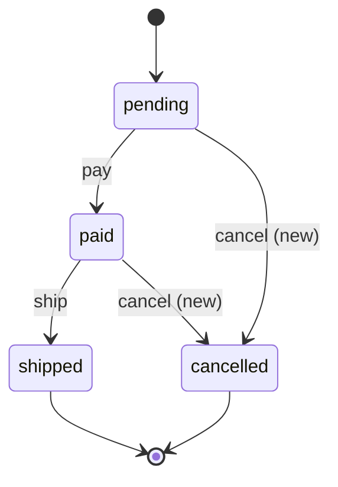
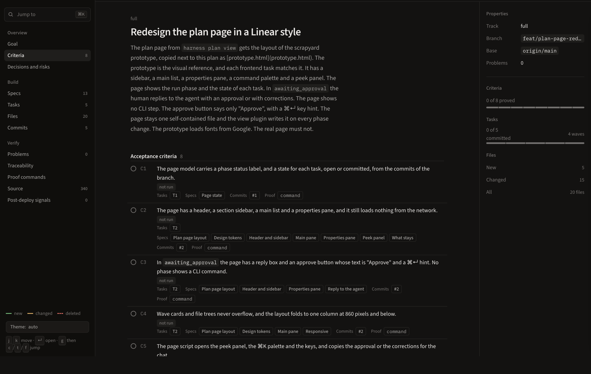
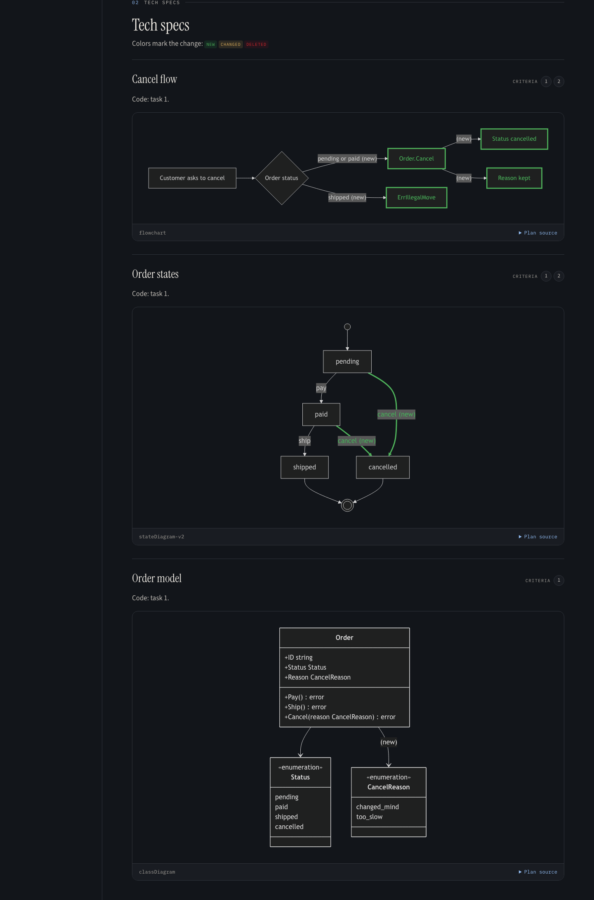
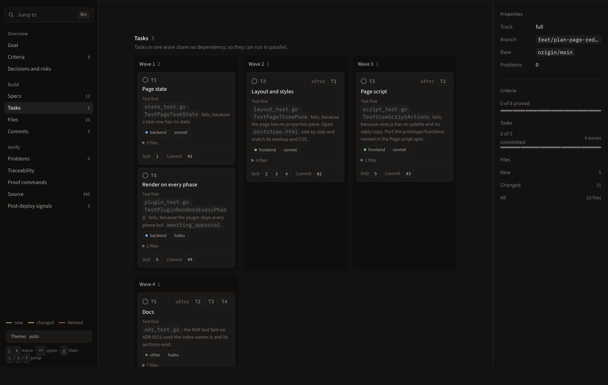
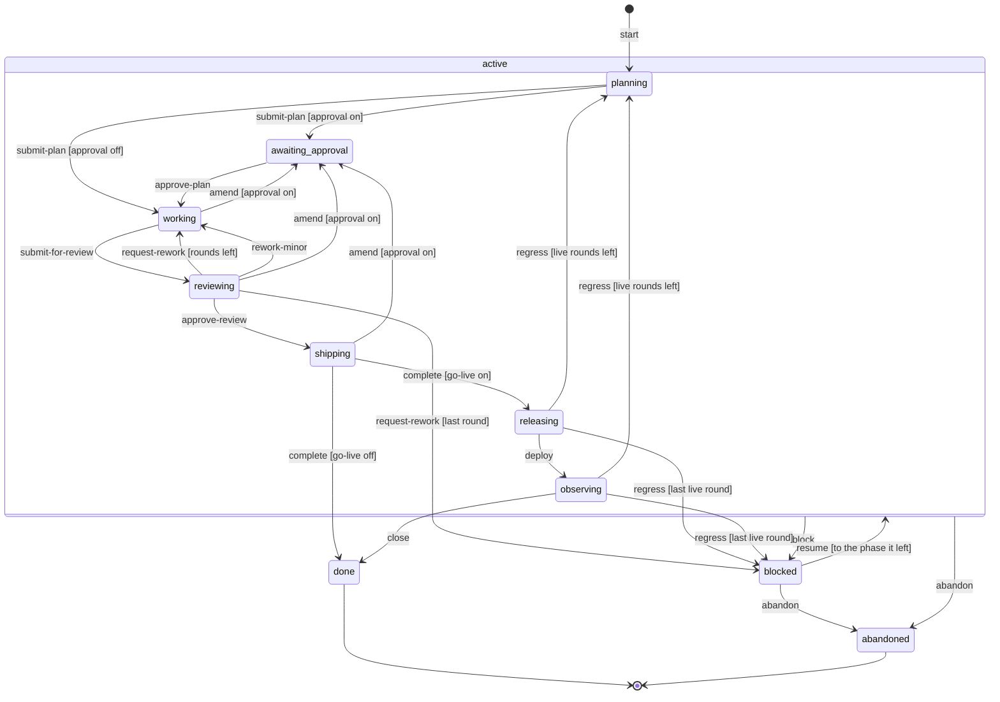

# Runs

This page holds a full run with its output, the plan view and the run phases, and the [README](../README.md) gives the short first run.

## A full run

This run is real output from a small Go repository. The agent normally runs these commands, and the hooks enforce the order.

```console
$ harness run start "Let a customer cancel an order before it ships"
run 20261108-132848-let-a-customer-cancel-an-order-before-it phase=planning review_round=0 live_round=0
models: lead=opus explorer=haiku worker=sonnet,haiku reviewer=sonnet,haiku,opus advisor=fable,opus
next: write the plan in .harness/runs/20261108-132848-let-a-customer-cancel-an-order-before-it/plan.md, then harness run plan
```

The `models:` line lists the models of each role for the host, from `roles` in the configuration. With two hosts, or with no detected host, it prints one line for each known host (`claude` and `codex`), named `models (claude):` and `models (codex):`.

Write `plan.md` in the run folder. `harness plan --help` gives the format. Write each diagram through `harness diagram`: a `+`, `*` or `-` at the end of a line marks it new, changed or removed. `harness diagram --help` gives the forms for each diagram kind.

```console
$ harness diagram < states.mmd
```



Check the plan, render it, and submit it:

```console
$ harness plan check
plan.md:43: note: diagram kind flowchart is not checked
advisor: on, model fable
wave 1: task 1, task 2
wave 2: task 3
$ harness plan view
.harness/runs/20261108-132848-let-a-customer-cancel-an-order-before-it/plan.html
$ harness run plan
run 20261108-132848-let-a-customer-cancel-an-order-before-it phase=awaiting_approval review_round=0 live_round=0
next: ask the Plan question; when the user picks Approve, run harness run approve
```

Before the plan, the `explorer` agent reads `docs/adr/index.md` first, then `CONTEXT.md`, the ADRs that the index names and the touched code. When the change alters behaviour that is not fully pinned, it also returns an evidence baseline. The lead asks the user about its ambiguous items in one round before `plan.md`. Each decision that the code cannot make goes under `## Open questions` in `plan.md`. After `harness run plan`, the agent grills the user in rounds through the question tool of the host (`AskUserQuestion` on Claude Code, `request_user_input` on Codex). Each answer moves to `## Decisions`.

The plan also needs `## Review risks`. Write `- none`, or one risk on each line with `Test:` and a backticked test name, or `Decision:` and text. The rule `risk-unanchored` checks it. A tree path with a `guard` or `security` folder needs `## Threat model` with the bullets `Attacker`, `Input forms` and `Fail closed`. The rule `threat-model` checks it.

A task that names a test also gives its seam in the `Test first` line, with the label `Seam:` and a backticked name. A task with a test and no seam gives the problem `seam-missing`. The rule checks only the form, and the advisor and the reviewer judge the choice.

A single-run plan has 6 tasks at most, and the rule `plan-size` checks it. Split a larger change into a multi-run plan. The template `skills/harness/references/plan-template.md` lists every plan check rule.

A bug has its own path. The plan carries the line `Cause: bug` under `## Goal` and the section `## Reproduction`. A `worker` agent runs the raw command before the plan exists. The lead writes the section with a criterion, a symptom, a regression test and 3 to 5 ranked hypotheses. The rule `reproduction` checks the form.

Then `harness verify --criterion <n>` runs only that proof and saves the evidence. The rule `reproduction-red` makes `harness run plan` refuse the plan until the proof failed on the current files and printed the symptom. When no seam exists for a regression test, write `Regression test: none: <reason>`. Then `harness run learn` lists a `no-seam` candidate.

When no question is open, the agent asks the `Plan` question with the options `Approve` and `Change the plan`. On `Approve`, the `post-tool-use` hook records the approval for the hash of the current `plan.md`. A plain reply in the chat records nothing.

```console
$ harness run approve
run 20261108-132848-let-a-customer-cancel-an-order-before-it phase=working review_round=0 live_round=0
next: implement test first, run harness verify, then harness run review
```

`harness run approve` refuses when no record matches the current `plan.md`, so an edit after the answer needs a new answer. It also checks `plan.md` again and refuses an open question, because the grill edits the plan after `harness run plan`. A model that the user names approves with `harness run approve --by <model> --reason "<one line>"`, and the transition log keeps both.

Write the test first. Each acceptance criterion of the plan is also a gate, `criterion-N`, that runs its proof command:

```console
$ harness verify
FAIL go-vet 83ms
FAIL go-test 89ms
FAIL criterion-1 81ms
FAIL criterion-2 87ms

go-vet:
...

go-test:
order/cancel_test.go:16:15: o.Cancel undefined (type *Order has no field or method Cancel)
...

FAIL gates=5 failed=4
error: gates failed
```

Write the code, commit, and verify again. `verify --commits` checks each commit in a temporary worktree: a `test:` commit must fail a gate, and every other commit must pass.

```console
$ harness verify
PASS gates=5 cached=0
$ harness verify --commits main
base origin/main 0a83514a6119
PASS commits=1
```

Submit the change for review. A plugin checks the branch against the plan first: the file trees, the commits, the owned files of each task, the tests and the proofs.

```console
$ harness run review
run 20261108-132848-let-a-customer-cancel-an-order-before-it phase=reviewing review_round=0 live_round=0
next: review the change, then harness run ship, or harness run rework --findings
$ harness run ship
run 20261108-132848-let-a-customer-cancel-an-order-before-it phase=shipping review_round=0 live_round=0
next: run harness run learn, open the pull request and run harness run wait --pr URL, then after the merge harness run done --pr URL
$ harness run wait --pr https://github.com/acme/shop/pull/42
run 20261108-132848-let-a-customer-cancel-an-order-before-it phase=shipping review_round=0 live_round=0
next: run harness run learn, open the pull request and run harness run wait --pr URL, then after the merge harness run done --pr URL
$ harness run done --pr https://github.com/acme/shop/pull/42
run 20261108-132848-let-a-customer-cancel-an-order-before-it phase=done review_round=0 live_round=0
next: the run is closed, start the next with harness run start
```

In `shipping`, `harness run wait --pr URL` records the open pull request on the run. The turn may then stop while the run waits on the merge.

On a full panel, the lead merges the findings of the reviewers and starts a verifier for each one. On a light panel no verifier runs, and the one reviewer sets the verdict and the severity. The lead writes them in `findings.md`. For the real open findings, the lead sends the run back once with `harness run rework --findings "..."`. A real open blocker or major finding gives `request-rework` and raises `review_round`. Only minor findings give `rework-minor` and keep it.

The text names each blocker or major ID. The guard rule `review-findings` refuses `harness run ship` while a real open blocker or major finding stays. It also refuses it when a real blocker or major finding, open or closed, has an ID that no reason names.

The guard acts on each tool call of the agent. For example, a merge goes to `harness hook --host claude pre-tool-use`, and the hook denies it:

```json
{"hookSpecificOutput":{"hookEventName":"PreToolUse","permissionDecision":"deny","permissionDecisionReason":"guard.pr-no-merge: a pull request merge is for the user. leave it to the user"}}
```

## Plan view

`harness plan view` writes the plan as one self-contained HTML page, with the diagrams, the file trees, the tasks and the state of each proof. The run also rewrites it on every phase change. In `awaiting_approval` the page holds a reply box: Approve copies a reply for the agent, and you paste it into the chat.

The page has three panes: a sidebar with each section and its count, the main list, and a properties pane. The properties pane holds the track, the branch and the progress bars. `j` and `k` move through the list, and `⌘K` opens a palette to jump to any section.







## Multi-run plan

A coordinator shows a program of runs as one page. The plan has `## Runs` and one `### R<n> slug` heading for each run. Each run has the fields Wave, Depends on, Branch, Owned files and Done when. A numbered scope list follows the bullets, with one step on each line.

```markdown
# Guard and coordinator plan

## Goal

Two runs make the guard exact and let the lead watch all runs.

## Runs

### R1 guard-precision

- Wave: 1
- Depends on: none
- Branch: feat/guard-precision
- Owned files: `internal/guard/domain/shell.go`
- Done when: a replay of the denied commands matches the expected result.

1. Follow `cd` before the source-path check.
2. Name the resolved file in each deny.

### R2 coordinator

- Wave: 2
- Depends on: R1
- Branch: feat/coordinator
- Owned files: `internal/run/ui/cli/list.go`
- Done when: the lead watches all runs with 1 command.

1. Add the list command for all runs.
```

- `harness plan check --file plan.md` lists each problem of the plan.
- `harness plan view --file plan.md` writes the page with the wave lanes, the dependency flowchart and the measurement.
- Each dependency names a run in an earlier wave.
- Runs in one wave own no common path.
- `harness run plan` refuses a multi-run plan with the rule `plan-kind`.

## Run phases

The phases and the events come from the transition table in `internal/run/domain`. A label in brackets is the guard that picks the row.



With `run.approval` off, `amend` from `working`, `reviewing` or `shipping` goes to `working`. A plan with only `docs` commits and `- none` under `## Open questions` also skips the approval on `submit-plan`.

An `amend` skips it only as a kept-structure amend or a docs-only amend. A docs-only amend has no approved copy to compare, so it may change the structure while the plan stays docs-only, like a fresh docs-only plan.

Some runs have no approval row for another reason. A run approved before approvals were recorded has none. A run planned with `run.approval: false` has none. A docs-only amend skips approval on these runs too.

Only an `amend` in the `working` phase skips the approval. `DESIGN.md` states the conditions. `docs/go-live.md` describes `releasing` and `observing`.

| Part | Where it acts |
|---|---|
| Plan check | `submit-plan`, `amend` and `approve-plan`: the plan rules, then the `plan.submitted` plugins |
| Gates | `harness verify` in `working`; the review needs a passing proof of each criterion |
| Trace check | `submit-for-review`: the trees, the commits and the owned files against the branch |
| Reviewers | `reviewing`: the agents of the `reviewer` role review the work. The common list runs on every listed model. Lens Spec runs on the first model, lens Standards on the second, and lens Spec on every other model. On a light panel one reviewer runs both lenses and no verifier runs. Otherwise a verifier checks each finding. With real findings, the lead runs `harness run rework` once with the verified list. A worker fixes each finding and a re-review checks each fix, both in `working`. The final panel then runs on the final `HEAD`. On a light panel it holds the first model only. Otherwise, after a small fixup, it holds the first 2 models and the models that raised the reworked findings. `harness review panel` prints it. `harness review list` prints the reviews recorded for `HEAD` and its patch id. Then the phase goes to `ship`, `rework` or `rework-minor`. `ship` needs a counted review of every model of the final panel. A review counts when it read a changed file and matches the `HEAD`, the patch id or the run. The run match ends at the last `request-rework`, `amend` or `regress`, and needs `findings.md` in the run folder |
| Guard | each tool call (`tool.before` and `tool.after`), each stop (`turn.stopping`) of the agent and each run transition (`run.transition.before`), in every phase |
| Plugins | every transition (`run.transition.before`, `run.transition.after`), each gate, each plan, each host hook, gate detection, lint and live signals |
| Live check | `releasing` and `observing`: `harness live check` reads the deploy and the signals |
