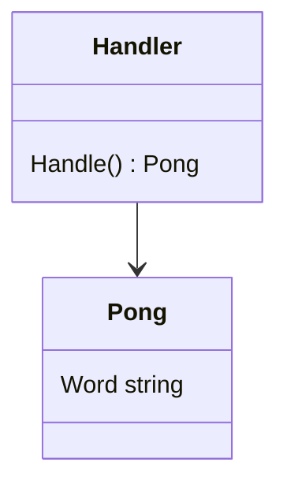
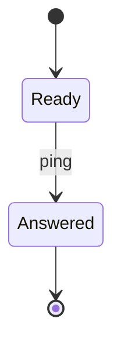

# Plan: add the ping query

## Goal

The service answers a ping with the word pong. The query records one span for each call.

Track: full

## Required skills

- `skills/ddd-conventions/SKILL.md`

## Acceptance criteria

| # | Criterion | Proof |
|---|---|---|
| 1 | The domain gives the word pong. | `go test ./internal/ping/domain -run TestPong -count=1` |
| 2 | The query returns the pong and records a span. | `go test ./internal/ping/application/query/pingquery -run TestPingQuery -count=1` |
| 3 | The module builds and passes all tests. | `make check` |

## Tasks

### 1. Ping domain

- Side: backend
- Owned files: `internal/ping/domain/pong.go`, `internal/ping/domain/pong_test.go`
- Test first: `pong_test.go`: `TestPong` fails, because `Pong` does not exist.
- DoD: criterion 1. The domain has no import outside the standard library.
- Depends on: none

### 2. Ping query

- Side: backend
- Owned files: `internal/ping/application/query/pingquery/`
- Test first: `handler_test.go`: `TestPingQuery` fails, because the handler does not exist.
- DoD: criteria 2 to 3.
- Depends on: task 1

## Signals

| Criterion | Metric | Panel | Alert | Threshold | Window |
|---|---|---|---|---|---|
| 2 | `ping.query` span count | ping calls | none | none | `24h` |

## Decisions

- 2026-11-08: Word (lead): the query returns the word pong in lower case.
- 2026-11-08: Span (lead): the query records one span for each call.

## Tech specs

### Ping domain

Code: task 1.
Criteria: 1

The domain holds the word that the query returns.



### Ping query

Code: task 2.
Criteria: 2 and 3

The handler returns the pong and records the span.



### Final code tree

```tree
harness/
└── internal/
    └── ping/
        ├── domain/
        │   └── pong.go                    new
        └── application/
            └── query/
                └── pingquery/
                    └── handler.go         new
```

### Final test tree

```tree
harness/
└── internal/
    └── ping/
        ├── domain/
        │   └── pong_test.go               new
        └── application/
            └── query/
                └── pingquery/
                    └── handler_test.go    new
```

### Commits

1. `feat: add the pong domain` (task 1)
2. `feat: add the ping query` (task 2)
3. `docs: describe the ping flow` (tasks 1 and 2)

### PR sequence

1. `feat/ping-query` (this run), based on `main`: the pong domain and the ping query.
2. `docs/ping-flow`: the flow notes.
