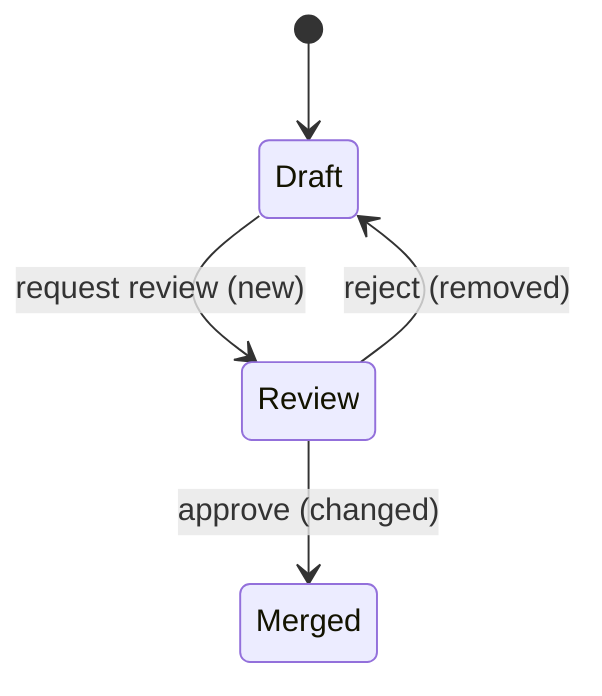
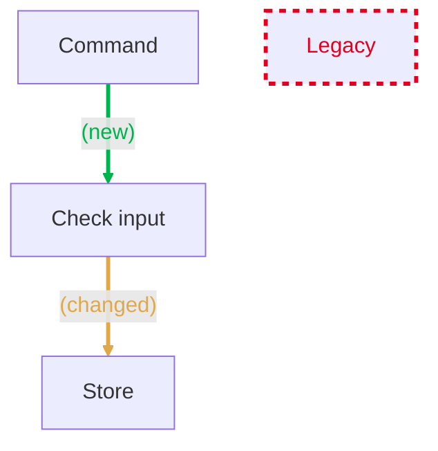
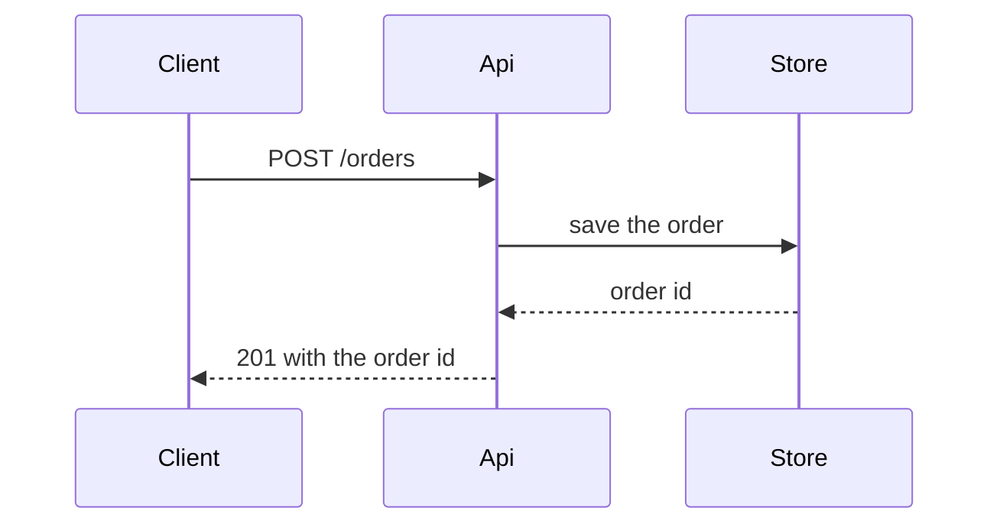
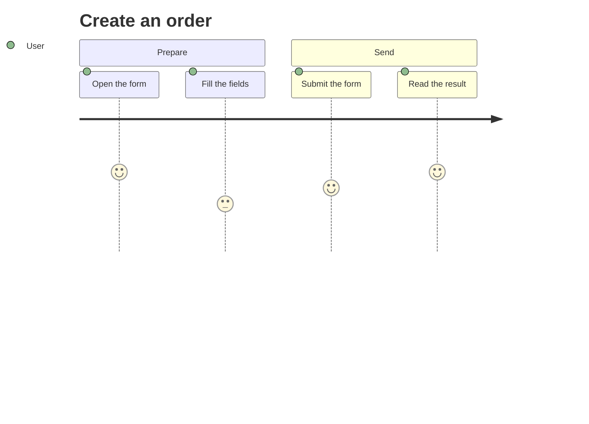
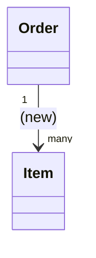
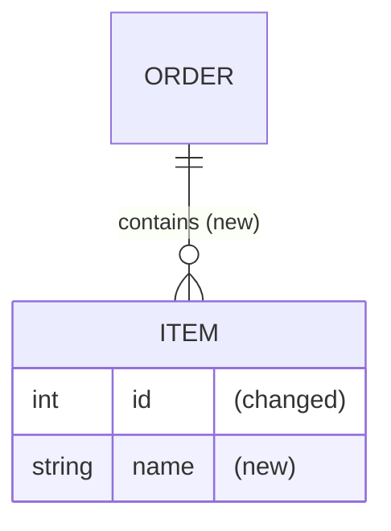

# Visuals of a pull request body

Pick a visual for each kind of change. Each example has the main point line as it goes in a PR body, above the fence. Mark a state, flow, class or ER visual with `harness diagram`. A `sequenceDiagram` and a `journey` take no mark.

## State diagram

Use it for a state or a phase change.

A draft now goes to review, an approval merges it, and a rejection no longer sends it back to draft.



## Flow chart

Use it for the steps of a command, a hook or a pipeline.

The command now checks its input before it stores, and the legacy step is gone.



## Sequence diagram

Use it for the calls between processes, an HTTP edge or a consumer, in time order.

The client posts an order, the API saves it in the store, and the client gets a 201 with the order id.



## Journey

Use it for the steps that a user takes in a flow, and how the user rates each step.

Creating an order takes four steps, and the user rates filling the fields lowest, at 3.



## Class diagram

Use it for a change of a domain model or of a contract.

A new Order class holds many items, and the Item class changes to fit.



## ER diagram

Use it for a schema change: a table, a column or a relation.

An order now contains items, and an item gains a name and changes its id.



## Wireframe

Use it for the layout of a UI change, as a boxed page or a CLI output, in a `text` fence.

The orders page lists each order with its item count and pages with Previous and Next.

```text
+------------------------------+
| Orders                  [New]|
+------------------------------+
| #1  Shipped        12 items  |
| #2  Pending         3 items  |
+------------------------------+
| < Previous           Next >  |
+------------------------------+
```
